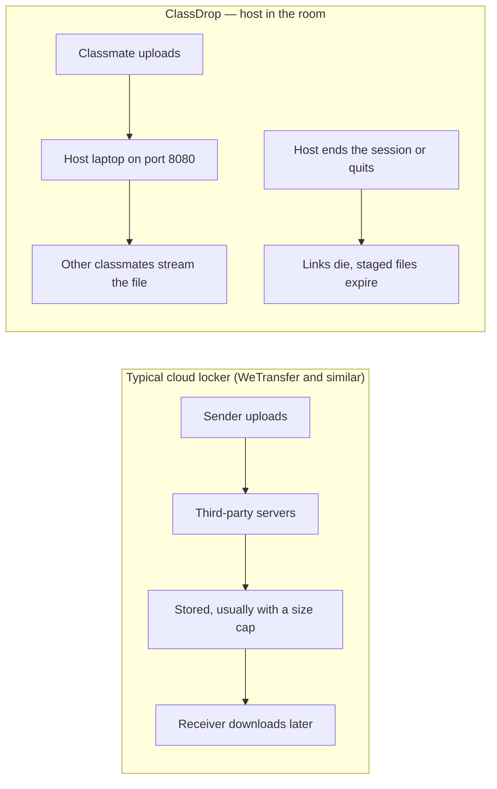
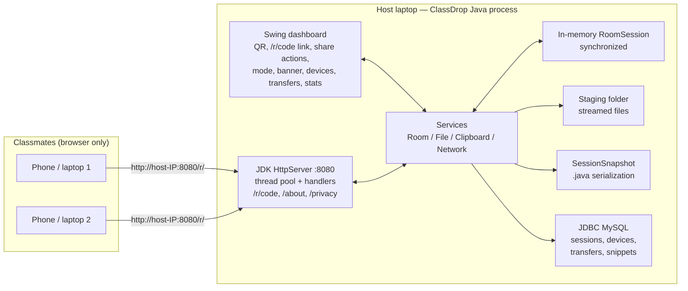

# ClassDrop — Offline Classroom File Sharing

**Build plan for the KJSIM (KJ Somaiya) MCA Java mini project**

| Field | Decision |
| --- | --- |
| Project title | ClassDrop — Offline Classroom File Sharing |
| Student | Farhan Sayed |
| Institution | K J Somaiya Institute of Management (KJ Somaiya), MCA |
| Topic-approval deadline | **23 November 2026** (Monday) — hard stop |
| Document date | 19 November 2026 (first version); **revised 23 November 2026** (Asia/Calcutta) to fold in a full ToffeeShare review |
| Stack (locked) | JDK 17+, Swing, `com.sun.net.httpserver.HttpServer`, JDBC + MySQL, JUnit 5 |
| Deployment | None. The host laptop *is* the server. |

This is the working plan for approval, build, test and viva. Decisions in this document are firm unless a gating test forces a fallback that is already named here. The 23 November revision adds ToffeeShare inspiration (section 2A) and the concrete features that follow from it. It does not reopen the stack, the 6-digit room code, Hotspot as the guaranteed demo, or the 23 November topic-approval deadline.

---

## 1. Exact idea

ClassDrop is a small Java desktop app that turns one student's laptop into a temporary classroom drop box. The host starts a session. Classmates on the same local network open a browser, enter a 6-digit room code (or scan a QR / open a short share link), and share files, images, code snippets and a shared clipboard. In LAN and Hotspot modes, file bytes stay in the room. Nothing is deployed to the cloud. Closing the host app, or ending the session, stops all sharing.

It is inspired by [ToffeeShare](https://toffeeshare.com/), but it is not a clone of that product. The full mapping — what we borrow, what we deliberately do differently, and how each idea is built in Java — is in **§2A**. In short: ToffeeShare is a browser WebRTC service with optional server fallback. ClassDrop is a Java project: a Swing host, an embedded JDK HTTP server that *relays* every transfer, Java multithreading, JDBC history, serialization, custom exceptions and a syllabus-shaped object model. The classroom constraint (same Wi-Fi or a hotspot, one 6-digit room code, no install for guests) is the product.

**Firm product rules**

1. Guests never install an app. Browser only.
2. The host laptop runs both the Swing dashboard and the embedded server on port **8080**.
3. A session is useless without the 6-digit room code.
4. The guaranteed viva demo is **Hotspot mode**, even if Somaiya Wi-Fi later turns out to allow peer traffic.
5. No Spring, no Tomcat, no Node backend. One JDK app plus a MySQL database on the host (XAMPP, MySQL Installer, or equivalent).

**Name.** ClassDrop. Package root: `com.classdrop`.

---

## 2. Features — MVP vs stretch

### 2.1 MVP (must ship; this is the demo)

- Host creates a session. App generates a **6-digit room code**, detects the usable LAN IP, and shows both on the dashboard. The same code is used everywhere (QR, share link, typed join). There is no second 4-digit pin — see §2A.3.
- Host sees a **QR code** and a **share link** of the form `http://<host-IP>:8080/r/<6-digit>`. A **Copy link** button, plus **WhatsApp** (`wa.me`) and **Email** (`mailto:`) deep links, send that URL.
- A visible **“keep the host app open”** banner: ending the session or closing the app stops all sharing, expires the room code and tokens, and cleans staged files. Guests see the same notice.
- Host can start, pause new joins, and end the session.
- Guests open the URL (or the pre-filled `/r/<code>` page), type a display name, then join. They may also type the 6-digit code on the plain `/` page.
- Guests **upload** and **download** files (images, documents, short code / text files). The guest page supports **drag-and-drop**, click-to-browse, and **multiple files**. Folders should be zipped first.
- Live transfer list on the host and the guest page: who, what, size, status, **progress**.
- Connected-device list on the host, with last-seen time.
- **Shared clipboard**: anyone in the room can post or read a short text/code snippet (ToffeeShare has no clipboard; this stays).
- Transfer history is stored in **MySQL** and can be **searched** on the host (by name, kind, device, date). A dashboard **stats counter** shows session and all-time totals (file count, bytes, success vs fail) from those tables.
- Session state and history can be **saved and restored** with Java serialization (so a demo can be resumed if the app is restarted).
- File size cap (default 100 MB, **configurable**), **chunked streaming** with no full-file `byte[]`, filename sanitising, path-traversal rejection, and auto-expiry of stored files.
- Three network modes in the UI, as a visible **fallback control**: LAN, Hotspot, optional Relay. The app shows which mode is active.
- Static **About** and **Privacy** pages, including a **“Cloud vs ClassDrop”** comparison and the honest line: in Modes 1–2, file bytes never leave the room; local MySQL keeps metadata for the academic history feature.
- A clean, **dark**, mobile-usable web UI with a teal accent (`#0D9488`). Do not copy ToffeeShare’s name, logo, or orange branding.
- Receiver access: a classmate needs the current room code and a device token to list or download. Access dies when the session ends.

### 2.2 Stretch (only after MVP gating criteria pass)

- Per-file **speed and ETA** on the progress row; a simple image preview.
- Host can remove a file or disconnect a device.
- Server-Sent Events (or short polling if SSE is messy) so the file list refreshes without a manual reload.
- Optional Cloudflare Tunnel / ngrok relay URL shown on the dashboard (Mode 3).
- "Keep for this class only" countdown (for example 90 minutes) with a cleanup thread already in MVP.
- Export a session report (CSV or a simple text log) from the search view.
- Allowed-extension list (soft block on executables such as `.exe`, `.bat`, `.cmd`, `.msi`, `.js` as a downloadable attachment — be honest in the viva that this is a classroom convenience, not antivirus).
- **Per-file download token** (and optional one-time link) so a share URL can point at one file, not the whole room.
- **Nearby hosts** on the Swing dashboard, via UDP broadcast/multicast (`DatagramSocket`, port 8081). Datagrams must not carry the room code. Browser guests still join with the QR / link / 6-digit code. See §2A.3.
- Optional **HTTPS** (`HttpsServer` + self-signed keystore) or **AES** of staged files. Describe these accurately; do not call them end-to-end encryption. See §2A.2.
- “Download all” as a zip; HTTP `Range` resume for a dropped download.
- Dark theme on the Swing host (web dark is in MVP). Extra social share buttons (Facebook, LinkedIn, Twitter) if you really want them — not needed for class.
- A higher file-size cap, or “until the disk is low,” only after the 100 MB streaming path is proven.

Do not start stretch work until the Week 3 gate is green. Do not build a consumer mobile app, a Windows Store port, an Explorer context menu, ads, or a language pack.

---

## 2A. ToffeeShare inspiration: what we borrow and how in Java

ClassDrop is inspired by [ToffeeShare](https://toffeeshare.com/), a free peer-to-peer file-sharing site from the Netherlands. This section is a feature-by-feature review of that product — taken from Farhan's screenshots of the live UI (share panel, comparison diagram, feature list, Nearby page, home page, navigation) and from the public pages `/`, `/about`, `/faq`, `/privacy`, `/nearby`, `/blog`, `/download` and the posts on fallback, Nearby Devices, dark mode and the Windows app — and then an honest map onto a one-person MCA Java mini project.

We borrow product ideas and classroom UX. We do **not** copy the name, logo, orange branding, layout, or marketing claims. We also do **not** pretend to be WebRTC. The Java host laptop is the classroom server; that is a deliberate syllabus choice, not a failed clone.

### 2A.1 What ToffeeShare actually does

**The origin story (About).** The author was next to a colleague, needed to send a large file, and could not: too big for email, no USB stick, mixed Mac/Windows so no AirDrop, and the file ended up split through WeTransfer — "literally sending it to another continent first." He could hand the colleague a toffee from a bowl on the table, but not a file. ToffeeShare is the proposed fix: send directly from the device, no cloud locker, no size cap, and on the same network the bytes need not leave the building.

**Home page.** Drag-and-drop or click to browse. Tagline: "No file size limit, Peer-to-peer, Blazingly fast, End-to-end encrypted." Navigation: Transfer, About, Blog, FAQ, Privacy, Download, plus a language toggle.

**Share panel (after a file is chosen).** Shows the filename and size, a share link of the form `https://toffeeshare.com/c/...`, a QR code for that link, and share buttons for WhatsApp, Facebook, Email, Gmail, LinkedIn and Twitter. Two checkboxes:

- **Local sharing code** (example from the live UI: `4987`) — a 4-digit code for nearby join.
- **Use fallback when no direct connection can be made** — optional relay through ToffeeShare's server if a direct peer path cannot be established (older browsers, or a network that blocks WebRTC). Off by default, because it is a privacy trade-off.

A flashing banner: *"Now sharing directly from your device — closing this page stops sharing, keep it open."* Files are available only while the sender's tab stays open (or the device stays on, in the mobile app). If the PC sleeps, the transfer typically becomes available again after 5–10 seconds. Nothing is stored in "the cloud"; closing the tab is how you stop access.

**How the transfer path works.** The default path is browser **WebRTC** (STUN under the hood). The two devices try to find the shortest route; on a friendly LAN the data may never leave the building. There is no intermediate locker and therefore no product-level file-size cap. Encryption on that path is **DTLS 1.3**. Typical speeds are quoted at 10–100 Mbit/s (rarely up to ~300 Mbit/s), limited by the slower of the sender's upload and the receiver's download. Corporate firewalls, busy Wi-Fi, isolation, and slow devices (the crypto is not free) all reduce that. Chrome and Firefox are first-class (P2P, fallback, no practical size cap). Edge is fine from v79. Safari can do P2P and fallback but may load the file into memory and fail around ~4 GB. Internet Explorer is unsupported.

**Fallback relay.** Introduced so transfers still work when WebRTC cannot connect. The file is then temporarily relayed via ToffeeShare's server instead of peer-to-peer. It is opt-in. Privacy page: they store no file bytes; they only keep aggregate daily counts (users, successful vs failed transfers, how often fallback was used) to spot outages.

**Nearby Devices** (`/nearby`). For phone ↔ computer on the same network, without typing a long link. The sender ticks "Share with nearby devices" and gets a **4-digit** local code. The receiver opens `toffeeshare.com/nearby`, types the code, taps Confirm, and is redirected to the private share link. Alternatively, "Send to PC" opens a camera to scan the QR on the Nearby page. ToffeeShare still uses a 4-digit code because a *browser* cannot reliably prove two devices are on the same LAN; they approximate "same network" by matching the **incoming public IP**, and the 4-digit pin stops strangers who share that IP (CGNAT, campus NAT, a café). Historically the main share link used a longer (~10 character) code; the 4-digit pin is only the local shortcut.

**Multiple files, not folders.** Several files can go in one share. Chrome or Edge is recommended for one-click multi-file download; other browsers may prompt once per file. Folders are not sent as folders — zipping in transit would slow a P2P stream — so the user zips first. Several people can download the same share at once (progress dots under the bar). Resume-from-offset after a dropped connection was started but is not something we should treat as a finished feature.

**Apps.** A mobile app (Android was in open beta; the download page also showed App Store artwork; store listings were not fully extractable from the HTML) can keep a share alive after the UI is closed, for as long as the phone is on and has a network. A Windows desktop app has been previewed (multiple transfers without extra tabs, persist after reboot, faster than the browser, experimental Explorer "share" that copies the link). Development of that app has been stalled and restarted; it is not a dependency for us. ToffeeShare originally began as a native STUN app and then moved to the browser.

**Privacy, stats, theme, ads.** "We don't store your data, period." The public boast is more than 50 TB transferred per month. Dark mode follows the device setting; the product accent was later shifted to orange. There are non-personalised ads and a language toggle. ClassDrop will take none of the ads, none of the branding, and no language pack.

**Known sharp edges (useful for our FAQ and viva).** Progress stuck at 0% usually means no connection. "100% but I don't see the file" is often the browser's downloader failing to save — retry. Safari / some Android background kills can abort a large transfer; keep the foreground open. Always keep a backup of important files; if the sender stops sharing early, the bytes are gone.

### 2A.2 Where ClassDrop is deliberately different

Be ready to say these three sentences in the viva. Do not copy ToffeeShare's homepage claims onto the ClassDrop UI.

**1. Host-relayed, not WebRTC P2P.** In ToffeeShare, once signalling has happened, file bytes go browser-to-browser (or through their optional relay). In ClassDrop, every upload and download goes through the **Java process on the host laptop** (`com.sun.net.httpserver.HttpServer` on port 8080). The receiver's page streams from the host; classmates are not connected to each other. That is what lets us show a Swing dashboard, a thread pool, a synchronized room store, JDBC history, and serialization — the actual syllabus. One host can serve the whole room. The cost is that the host is a hop, and the host must stay open.

**2. Encryption is optional and must be described accurately.** ToffeeShare's path is DTLS 1.3 end-to-end between the two browsers. ClassDrop's default on LAN and Hotspot is **plain HTTP**. Anyone on that same network who has the room code can join. That is acceptable for a same-room demo; it is not "end-to-end encryption." If there is time after Gate 4:

- **Optional HTTPS (stretch):** JDK `HttpsServer` plus a self-signed keystore (`keytool`). The wire is then TLS. Browsers will show a certificate warning; say so. This protects the hop from casual sniffing on the hotspot. It is *transport* security, not E2E in the ToffeeShare sense, because the host process can still read the bytes.
- **Optional AES for files on disk (stretch):** encrypt staged files with a session key so a shared lab laptop is slightly safer at rest. This is not wire encryption and is not E2E.

Never put "End-to-end encrypted" on the ClassDrop home page unless you have actually built a design where the host cannot read the file (we are not doing that in this mini project).

**3. "No file size limit" becomes streaming plus a configurable cap.** ToffeeShare can skip a cap because it never stores the file. ClassDrop *does* stage bytes on the host disk, so a cap is required to protect the laptop. The important part we *do* borrow is the engineering: **stream in chunks, never `readAllBytes()` or buffer the whole file in a `byte[]`.** Default `MAX_FILE_SIZE` is **100 MB**, read from `application.properties` so you can raise it for a demo. The cap is enforced as soon as the declared or running size exceeds it; a rejected upload must not leave a giant partial file. A stretch "until the disk is low" mode is allowed only after the 100 MB path is proven. Also stream the *download* (`Content-Disposition` attachment) so we do not hit Safari-style in-memory limits on the receiver.

A fourth, smaller difference is worth stating: ToffeeShare stores **no** history. ClassDrop **does** keep local MySQL metadata (names, sizes, device names, timestamps) because searchable JDBC history is a graded requirement. File *bytes* still leave the disk when the session ends. Say this on the Privacy page; do not copy "We don't store your data, period."

### 2A.3 One code, not two: 6-digit room vs 4-digit nearby

ToffeeShare has two codes: a longer share-link code, and a 4-digit local pin for Nearby. ClassDrop will **not** add a second 4-digit pin.

**The single join secret is the 6-digit room code** already in this plan. It is what the QR encodes (inside the share URL), what a classmate types, what WhatsApp and email carry, and what the Nearby flow would confirm. Reasons:

- A class of 60 on a shared campus NAT makes a 4-digit pin (10,000 values) too tight; six digits (1,000,000 values), plus a short per-IP delay after failed attempts, is enough for a live class.
- Two codes on a dashboard confuse the viva and the classroom.
- ToffeeShare needed the short pin because their meeting point is a *public website* and their "same network" check is only "same public IP." ClassDrop's meeting point is the host laptop in the room (projector, QR, or a WhatsApp link). We do not need a second pin to compensate for a global website.

Share URL form (ClassDrop equivalent of `https://toffeeshare.com/c/...`):

```
http://<host-IPv4>:8080/r/<6-digit>
```

Example: `http://192.168.137.1:8080/r/482917`. The QR encodes this URL. Opening it shows the join page with the code already filled; the classmate only types a display name. The room code is still required. A public or tunnel URL without the code must not list files.

**Nearby, honestly.** ToffeeShare Nearby works because everyone can already open `toffeeshare.com`. ClassDrop has no public website, and a *browser guest cannot listen for UDP*. So we do not promise a magic "scan the room from Chrome with no IP." The classroom equivalent of Nearby is:

1. **MVP (this is the real nearby experience):** the host screen shows the QR, the share link and the 6-digit code. Copy link, WhatsApp (`wa.me/?text=...`) and Email (`mailto:?subject=...&body=...`) buttons send that URL. A classmate on the same LAN or hotspot opens it and joins. This is enough for the demo.
2. **Stretch — UDP host discovery, Java side only:** the host process announces itself with `DatagramSocket` (broadcast or multicast, for example UDP port **8081**) about every two seconds. A **Swing "Nearby hosts" panel** lists other ClassDrop sessions on the LAN: display name, IP, port. The datagram must **not** include the room code (anyone sniffing UDP would then have the secret). A classmate who can see that IP still opens the browser at `http://<ip>:8080/r/...` or types the 6-digit code from the host screen. If client isolation blocks UDP, the list is empty and the MVP path still works. Add a Windows Firewall UDP 8081 rule only if this stretch is built.

### 2A.4 Feature-by-feature mapping

| ToffeeShare feature | ClassDrop equivalent | Java / web implementation | MVP or stretch | Phase |
| --- | --- | --- | --- | --- |
| Drag-and-drop or click to browse on the home page | Same, on the guest page after join (and a file chooser on the host if useful) | HTML5 `dragover` / `drop` + `<input type="file" multiple>` in `app.js`; host can use `JFileChooser` | **MVP** (web) | 2–3 |
| Filename + size on the share panel | Live transfer table and the guest file list show original name + size | `SharedItem.getOriginalName()` / `getSizeBytes()`; Swing table + `GET /files` JSON | **MVP** | 2–3 |
| Share link `https://toffeeshare.com/c/...` | `http://<ip>:8080/r/<6-digit>` (HTTPS only if a tunnel or the HTTPS stretch is on) | `GET /r/{code}` serves the join page with the code pre-filled; `NetworkInfoService` builds the URL | **MVP** | 1 (route), 3 (dashboard copy) |
| QR code of the share link | QR of the `/r/<code>` URL | Existing `QrService` (Nayuki or ZXing) | **MVP** | 3 |
| WhatsApp / Email / Gmail / LinkedIn / Twitter / Facebook buttons | **WhatsApp and Email only** for the classroom. Other social buttons are optional and low value | `ShareLinks.java`: `https://wa.me/?text=` + URL-encoded message, `mailto:?subject=ClassDrop room&body=...`. Buttons on the Swing dashboard and the guest page | **MVP** (WA + mail). Other networks = stretch, not recommended | 3 |
| 4-digit "Local sharing code" checkbox | One 6-digit room code, used everywhere (see §2A.3) | `RoomCodeGenerator`, already specified | **MVP** | 1 |
| "Use fallback when no direct connection can be made" | Visible **network fallback** control: LAN → Hotspot → optional tunnel. Not a WebRTC relay | `NetworkMode` enum; dashboard radio/combo + a "Test page" / health hint; tunnel URL field only in Mode 3 | **MVP** (mode switch). Auto-detect remains best-effort | 3 (UI), Mode 3 stretch |
| "Keep this page open or sharing stops" banner | Banner on the **host dashboard** and a notice on the guest page: "Keep the ClassDrop app open on the host laptop. Ending the session or closing the app stops all sharing." | Swing banner (`JLabel` / `JPanel`); HTML notice. `endSession()` and process exit invalidate codes and tokens, cleanup deletes staged files | **MVP** | 3 (banner), 2 (stop = expire) |
| WebRTC "straight from your device / shortest path" | **Direct device-to-room:** receiver streams from the host; bytes stay on the LAN or hotspot in Modes 1–2 | `DownloadHandler` streams from `data/<sessionId>/...`; no cloud upload | **MVP** | 2 |
| "No file size limit" | Chunked streaming, no in-memory buffer, **configurable cap** (default 100 MB) | `FileService.storeUpload` with a fixed-size buffer (8–16 KB). `max.file.size.bytes` in properties. `FileTooLargeException` → 413 | **MVP**. Higher / "disk-limited" cap = stretch | 2 |
| "Only the receiver can access" (DTLS 1.3 E2E) | Room code + device token required to list or download. Optional **per-file token** on a file link. Auto-expiry when the session ends | Token on `X-ClassDrop-Token`. Stretch: `GET /download/{id}/{fileToken}`; one-time consume is a further stretch. No DTLS E2E claim | **MVP** (room + device token + expiry). Per-file / one-time token = stretch | 2, stretch in 4 |
| Low environmental impact / "no bulky servers" | No cloud deployment. The host laptop *is* the server. Talking point on the Privacy / About page and in the viva | Static `/privacy` and `/about` pages; "Cloud vs ClassDrop" diagram in §2A.5 | **MVP** (static pages) | 3 |
| "50 TB / month" marketing counter | Host dashboard **stats**: total bytes transferred, successful vs failed transfers, session count — from MySQL | `StatsService` + `SUM(size_bytes)`, `COUNT(*)` grouped by `status`. Session total and all-time total | **MVP** (Phase 4, with JDBC) | 4 |
| Nearby Devices page (QR or 4-digit, Confirm) | MVP: QR + link + 6-digit code. Stretch: Swing UDP discovery list (no room code on the wire) | Stretch: `DiscoveryService` + `DatagramSocket` on UDP 8081 | Nearby UDP = **stretch** | 3–4 if time |
| P2P vs third-party comparison graphic | Static **"Cloud vs ClassDrop"** diagram on `/about` and in the report / viva | SVG or a simple HTML+CSS graphic in `resources/web/about.html`. Do not use their artwork | **MVP** | 3 |
| Privacy page ("we store nothing; only aggregate stats") | `/privacy`: "In LAN and Hotspot modes, file bytes never leave the room." Honest note that **local MySQL keeps metadata** for the academic history feature, and that bytes are deleted when the session ends | Static page + the stats queries above | **MVP** | 3–4 |
| Dark mode + orange accent | **Dark theme** on the web client, and on Swing if time, with **our own accent** (teal `#0D9488`, not their orange). No toffee/candy imagery, no "Toffee" word in the UI | CSS variables in `app.css`; optional later FlatLaf or manual Swing colours. Follow `prefers-color-scheme` if easy | Web dark + accent = **should-do in Phase 3**. Swing dark = stretch | 3 |
| Multiple files in one share; zip folders yourself | Multi-file picker and drop; list + per-file progress. Tell users to zip a folder first | `multiple` file input; one `POST /upload` per file (simpler than one multipart with many parts). Optional "Download all" zip = stretch | **MVP** (multi-file + progress). Zip-all / folder = stretch | 2–3 |
| Per-transfer progress; speed limited by the slower side | Progress on host table and guest list; **speed and ETA** as a stretch | Callback from the stream thread: bytes written / total. `invokeLater` for Swing. Speed = delta bytes / delta time | Progress = **MVP**. Speed / ETA = stretch | 2–3 |
| Several receivers at once | Already required: thread pool, concurrent uploads/downloads, live table of in-flight transfers | `HttpServer` fixed pool; no session lock held during the stream | **MVP** | 2 |
| Mobile / Windows apps, Explorer integration, persist after reboot | The **Swing host is the desktop app**. Guests stay browser-only (firm rule). Persist-after-restart is `SessionSnapshot` serialization, already planned. No Play Store / Explorer shell extension | Existing host app + serialization | App-store ports = **out of scope**. Serialization = **MVP** | 4 |
| Resume a broken transfer from an offset | HTTP `Range` on download | `DownloadHandler` honours `Range` if built | **Stretch**, only after Gate 4 | After 4 |
| Language toggle, ads, blog, status page | None | — | **Out of scope** | — |
| Shared clipboard | ToffeeShare has no clipboard. ClassDrop **keeps** the shared clipboard — a classroom differentiator (codes, links, a few lines of answers) | Existing `ClipboardService` | **MVP** | 3 |
| Optional HTTPS / AES (our addition, not a ToffeeShare clone) | See §2A.2 | `HttpsServer` + keystore, or AES at rest | **Stretch** | After 4 |

### 2A.5 "Cloud vs ClassDrop" comparison (use this in the viva and on `/about`)



| | Typical cloud locker | ToffeeShare | ClassDrop |
| --- | --- | --- | --- |
| Where the bytes sit | Their servers | On the two devices only (P2P); optional relay if you tick fallback | On the **host laptop** only, for the life of the session |
| Path | Upload, then download | WebRTC peer-to-peer, STUN, optional server relay | **Host-relayed HTTP** (all guests talk to the Java server) |
| Size | Usually capped | No product cap (browser limits apply, Safari ~4 GB) | Streamed in chunks; **100 MB default cap**, configurable |
| How you join | Email or a cloud link | `/c/...` link, QR, or 4-digit Nearby code | `/r/<6-digit>` link, QR, or typed 6-digit room code |
| When access stops | When the locker expires, often days later | When the sender closes the tab | When the host ends the session or closes the app |
| History | Their account | None (aggregate counts only) | **Local MySQL** metadata for search; bytes are still deleted |
| Classroom clipboard | No | No | **Yes** — short text / code snippets |
| Install for guests | Browser | Browser (apps optional) | Browser only |
| Encryption claim | HTTPS to their servers | DTLS 1.3 E2E on the P2P path | Plain HTTP on LAN/Hotspot, unless the HTTPS stretch is on. Do not claim E2E |

**Suggested ClassDrop tagline** (home page and dashboard): "In the room, in the browser, off the cloud." Do not use "Peer-to-peer," "No file size limit," or "End-to-end encrypted."

### 2A.6 Concrete behaviours to implement (so this is not just a table)

1. **Keep-host-open banner.** Visible whenever a session is live. Ending the session is the ClassDrop equivalent of closing the ToffeeShare tab: room code and tokens die, `/files` and `/download` fail, cleanup deletes the session folder.
2. **Share actions.** "Copy link" already planned. Add **Share on WhatsApp** and **Email link** next to it. Pre-filled text: `Join my ClassDrop room: http://<ip>:8080/r/482917` (use the live IP and code). These are deep links only; the app does not talk to WhatsApp or Gmail APIs.
3. **Guest page.** After join: drag-and-drop zone, click to browse, multiple files, a list with name, size, progress, and download. Clipboard box stays. A short footer links to About and Privacy.
4. **About and Privacy pages.** Static HTML. About tells the classroom story (pass a file the way you would pass a note, without sending it to another continent) and shows the comparison diagram. Privacy says: Modes 1 and 2, file bytes stay in the room; the host can see what is in the drop box (they are the server); MySQL stores names, sizes and device names for the project; we do not send files to a public cloud; stats on the dashboard are local counts.
5. **Stats counter.** After JDBC exists, the dashboard shows "This session: N files, X MB" and "All recorded sessions: …" from `transfers`. Nice, honest viva moment. No fake "50 TB" number.
6. **Fallback control.** The dashboard makes the three modes obvious, the same way ToffeeShare makes the fallback checkbox obvious. Default recommendation: try LAN if the isolation test passed, otherwise Hotspot. Mode 3 is off unless the host pastes a tunnel URL.
7. **Auto-expiry.** Already in §10. Keep it: session end, plus an optional 2-hour (or "this class only," e.g. 90 minutes) countdown.
8. **Theme.** Dark, readable web UI with teal accent `#0D9488` (or another accent that is *not* ToffeeShare orange). High contrast, large join fields, works on a phone in a lecture hall.

### 2A.7 What we will not take from the site

- The name, logo, mascot, orange palette, or any ToffeeShare screenshot in the UI.
- A claim of WebRTC, STUN, DTLS, or end-to-end encryption.
- A second 4-digit nearby pin.
- Ads, donations, language packs, a public blog, or a status page.
- A consumer mobile or Windows Store app, or an Explorer context-menu plugin.
- Folder-as-folder transfer, or a promise of unlimited disk use on the host.
- Treating resume-from-offset as an MVP feature.

### 2A.8 Sources for this section

Reviewed 23 November 2026 (Asia/Calcutta):

- Live UI screenshots supplied with this revision: share panel (filename, size, `https://toffeeshare.com/c/...` link, QR, six share buttons, 4-digit local code `4987`, fallback checkbox, keep-open banner); the P2P vs third-party diagram; the five feature tiles (straight from the device / WebRTC, no size limits, only the receiver / DTLS 1.3, low environmental impact, 50 TB/month); the Nearby page (scan QR or enter a 4-digit code, Confirm, phone ↔ computer); the home page (drag-and-drop, four-part tagline); the top navigation.
- Public pages fetched: [toffeeshare.com](https://toffeeshare.com/), [/about](https://toffeeshare.com/about), [/faq](https://toffeeshare.com/faq), [/privacy](https://toffeeshare.com/privacy), [/nearby](https://toffeeshare.com/nearby), [/blog](https://toffeeshare.com/blog), [/download](https://toffeeshare.com/download), and posts on [fallback](https://toffeeshare.com/blog/11/Introducing-fallback-option-for-better-network-support/), [Nearby Devices](https://www.toffeeshare.com/blog/25/Quickly-transfer-files-on-your-Local-Network-with-Nearby-Devices/), [dark mode](https://www.toffeeshare.com/blog/28/Introducing-dark-mode-and-other-upcoming-features/), [Windows app / orange accent](https://toffeeshare.com/blog/29/Transfer-files-(even)-faster-on-Windows/), [multiple transfers and the toffeesha.re link](https://www.toffeeshare.com/blog/14/Multiple-transfers-at-once-and-getting-ready-for-mobile/), and [planned resume](https://www.toffeeshare.com/blog/12/Series-of-updates-to-the-platform/).

Gaps: the download page listed "the following platforms" mainly as images, so exact store links and iOS availability were not fully confirmed from the HTML. The FAQ extract ended at the browser-support table; any questions after that were not in the fetched text. A few older blog posts (zip walkthrough, Android steps, speed-tips, ads, multilingual) were only seen as titles or summaries. None of those gaps changes the build decisions above.

---

## 3. Network reality (read this before writing code)

Somaiya campus Wi-Fi uses a **personal student login** (typical WPA2-Enterprise / 802.1X). That login only answers: *is this person allowed on the network?* It does **not** automatically mean two laptops can talk to each other.

Once a student is connected, the device still gets its own local IP. On Windows that IPv4 address is visible in `ipconfig`. Addresses in classroom networks are often in private ranges such as `10.x.x.x` or `192.168.x.x`, but **do not assume a specific Somaiya range** — always read it from the machine.

The setting that decides whether ClassDrop works on college Wi-Fi is **client isolation** (also called AP isolation or station isolation). It is a controller / access-point option, not something you can see from the login screen.

| Isolation | What happens | ClassDrop |
| --- | --- | --- |
| Off | A classmate can open `http://<your-IP>:8080` | LAN mode works |
| On | Ping and port 8080 time out, even though both of you are "on Wi-Fi" and the internet works | LAN mode fails; use Hotspot |

You will not know which of those is true until you run the test in §3.4. Treat the result as a fact, not a hope. Many campus networks turn isolation on. Plan the demo around Hotspot either way.

### 3.1 Mode 1 — Same Wi-Fi / LAN

Use this when the isolation test passes.

- Host and guests are on the same Somaiya SSID (each with their own id and password).
- Guests browse to `http://<host-IPv4>:8080`.
- The ClassDrop process must also be allowed through **Windows Firewall** on the host (§3.5). A failed firewall rule looks identical to isolation: the page never loads.

### 3.2 Mode 2 — Hotspot (guaranteed demo mode)

This is the mode you rehearse and the mode you use in the viva if LAN fails.

- Start a hotspot from the host laptop (**Windows Settings → Network & internet → Mobile hotspot**) or from a phone, then put the host laptop on that hotspot.
- If the **laptop** is the hotspot, Windows commonly gives the host `192.168.137.1`. Confirm with `ipconfig`; do not hard-code it.
- If a **phone** is the hotspot, both the host laptop and the guests join the phone. The host IP is whatever `ipconfig` shows on the laptop (iPhone hotspots are often `172.20.10.x`; Android varies).
- Guests switch Wi-Fi to the hotspot, then open the URL. No college firewall and no isolation is involved.
- Trade-off: the host laptop (or the phone) may lose campus internet while the hotspot is on. That is acceptable for a classroom demo. Say this in the viva.

### 3.3 Mode 3 — Optional internet relay (bonus only)

A local tunnel such as **Cloudflare Tunnel** or **ngrok** runs on the host and gives a public HTTPS URL that forwards to `localhost:8080`. Guests can then join from another network. This is ClassDrop’s equivalent of ToffeeShare’s optional “use fallback when no direct connection can be made” checkbox: it is **opt-in**, it still serves files from the host laptop, and it is off unless you need it.

This is a stretch feature, not a dependency.

- Files still live on the host laptop. You are not deploying a server.
- Some college firewalls block these tools. If the tunnel cannot start on campus, drop Mode 3 for that session and use Mode 1 or 2.
- The room code and file-size limits still apply. A public URL without a room code would be unsafe.

### 3.4 Two-minute isolation test (do this on campus, 20 Nov if possible)

Need: your laptop, one friend's laptop or phone, both on Somaiya Wi-Fi.

**On the host laptop**

1. Open Command Prompt and run `ipconfig`.
2. Note the **IPv4 Address** of the Wi-Fi adapter (not VirtualBox, not Ethernet, not `127.0.0.1`).
3. Start a disposable test server (this is not ClassDrop; it only tests reachability):

```bat
python -m http.server 8080
```

If Python is missing, any temporary listener on 8080 is fine. Keep the window open.

**On the friend's device, on the same Somaiya Wi-Fi**

4. Ping the host:

```bat
ping <host-IPv4>
```

5. In a browser, open `http://<host-IPv4>:8080`.

**How to read the result**

| Ping | Browser page | Meaning | What you do |
| --- | --- | --- | --- |
| Replies | Page opens | Isolation is off, path is clear | LAN mode is viable. Still enable the firewall rule before the Java demo. |
| Time out / "Destination host unreachable" | Page hangs | Client isolation (or a campus firewall) is blocking peer traffic | Do not fight the network. Demo on Hotspot. |
| Ping works, page fails | Only port 8080 is blocked, or Windows Firewall is dropping inbound TCP | Add the firewall rule in §3.5 and retest | If it still fails, treat it like isolation and use Hotspot. |

Also test once from the friend's **phone** on Somaiya Wi-Fi. Phones are what classmates will actually use.

Repeat a short version of this test on the **hotspot** as well, so you have one passing path on video or in notes before the viva.

### 3.5 Windows Firewall (host laptop)

Windows will often silently drop inbound port 8080 even when isolation is off. Do this on the host before any LAN test with Java.

Open **Command Prompt as Administrator** and add an inbound rule for TCP 8080 on the private profile:

```bat
netsh advfirewall firewall add rule name="ClassDrop HTTP 8080" dir=in action=allow protocol=TCP localport=8080 profile=private
```

Check it:

```bat
netsh advfirewall firewall show rule name="ClassDrop HTTP 8080"
```

If you need to remove it later:

```bat
netsh advfirewall firewall delete rule name="ClassDrop HTTP 8080"
```

Also allow the **Java** program through Windows Defender Firewall for **Private** networks (Windows Security → Firewall & network protection → Allow an app through firewall). If the laptop is on a network Windows marked as Public, either switch that network to Private or add the same rule with `profile=public` only after you understand the risk (classroom / hotspot is usually Private).

ClassDrop should print a one-line reminder on startup: "If classmates cannot open the URL, check Windows Firewall and the isolation test."

### 3.6 How the app detects IP and mode

On session start, and again on a Refresh button:

1. Enumerate `NetworkInterface` devices that are up, not loopback, and have an IPv4 address.
2. Skip obvious virtual adapters when possible (names containing `VirtualBox`, `VMware`, `Hyper-V`, `vEthernet`, `Docker`, `WSL`).
3. Prefer the adapter that is actually carrying traffic. Show **all candidates** in a dropdown if more than one remains, with the preferred one pre-selected.
4. Classify mode with simple, honest rules (not magic):
   - **Hotspot**, if the laptop is advertising a Mobile Hotspot, or the chosen IPv4 is the typical Windows hosted-network address `192.168.137.1`, or the user picks "Hotspot" manually.
   - **Relay**, if a tunnel URL has been pasted or detected.
   - **LAN** otherwise.
5. The dashboard always shows: active mode, chosen IPv4, the share URL (`http://<ip>:8080/r/<code>`), room code, QR, a "copy link" button, WhatsApp and Email share actions, and the keep-host-open banner.

Never hard-code a campus IP. Never assume isolation is off because "we all logged into the same Somaiya Wi-Fi."

---

## 4. Syllabus mapping

Every item Sir listed is used in a real ClassDrop path, not as a dummy class.

| Java concept | Where it appears in ClassDrop |
| --- | --- |
| Classes, objects, constructors and methods | `Player`-style domain: `SharedItem`, `RoomSession`, `Device`, `TransferRecord`, `ClipboardEntry`, plus services and Swing panels. Every entity has a real constructor and behaviour, not empty getters only. |
| Method and constructor overloading | `SharedItem` has a short constructor (new upload) and a full constructor (reload from DB / serialization). `send(Path file)` and `send(Path file, String roomCode)` on the service. `ClassDropServer.start()` and `start(int port)` (tests use another port). |
| Abstract classes and interfaces | Abstract `SharedItem` with subclasses `ImageFile`, `DocumentFile`, `CodeSnippet`. Interface `Transferable` (id, size, content type, `openStream()`). A second interface `SessionListener` lets the Swing UI observe transfers without the server knowing about Swing. |
| Inheritance and Wrapper classes | The `SharedItem` hierarchy is classical inheritance. Sizes, ports and counts use `Long` / `Integer` wrappers at API and JDBC boundaries (`ResultSet.getLong`, nullable size, parsing form fields). Do not invent pointless wrapper demos; use them where values cross I/O. |
| Static and final variables | `public static final int PORT = 8080`; `public static final long MAX_FILE_SIZE = 100L * 1024 * 1024`; `public static final int ROOM_CODE_LENGTH = 6`; a `static` active-session / active-user counter on `RoomSession` or `SessionRegistry`, incremented and decremented in synchronized methods. |
| Exception handling, including custom exceptions | `InvalidRoomCodeException`, `FileTooLargeException`, `TransferFailedException`, `SessionExpiredException`. Handlers catch these and return clean HTTP 4xx/5xx with a short message. Swing shows the same errors in a dialog. Also handle `SQLException` and `IOException` at the boundaries. |
| Packages | `com.classdrop.model`, `com.classdrop.service`, `com.classdrop.server`, `com.classdrop.web` (the HTML/JS assets and the idea of the browser client), `com.classdrop.db`, `com.classdrop.ui`, `com.classdrop.exception`, `com.classdrop.util`. No default-package code. |
| Multithreading for "payroll-style" processing | The HTTP server runs on a **thread pool**. Each guest request is a handler task. Uploads and downloads stream concurrently. A **synchronized** (or `ReentrantReadWriteLock`) in-memory session store is the single authority for the current room. A **cleanup thread** expires old files and stale devices. Swing is updated with `SwingUtilities.invokeLater` only — never from a worker thread. A small progress callback flows from the stream thread to the UI. |
| File handling and serialization | File bytes are **streamed** to a staging folder (never `readAllBytes()` for user uploads). This is how ClassDrop approaches ToffeeShare’s “no size limit” idea without pretending the host has infinite disk: a configurable cap, chunked I/O. Original names live in the database; stored names are generated ids. `SessionSnapshot` is **Java-serializable** so a session and its transfer history can be saved to disk and restored. |
| Swing GUI | Host dashboard: room code, IP, mode, share URL, QR, copy/WhatsApp/Email, keep-open banner, start/end session, connected devices, live transfers with progress, stats counter, shared-clipboard monitor, search over history, log pane. Stretch: Nearby hosts list. |
| JDBC | MySQL tables `sessions`, `devices`, `transfers`, `snippets`. Host search runs SQL with prepared statements. Stats (`SUM(size_bytes)`, counts by status) come from the same tables. The live room can work even if MySQL is briefly down (memory-first, DB write with a clear error in the log), but the graded search-history feature requires MySQL to be up for the demo. |

If the Nearby UDP stretch is built, mention `DatagramSocket` as an extra networking demonstration — it is not a required syllabus row.

That mapping should be copied, shortened, into the approval form and into the project report.

---

## 5. Architecture

One process on the host. Guests are ordinary browsers. MySQL runs locally on the host.



**Data flow for an upload**

1. Guest submits `POST /upload` with the room token and a multipart file.
2. A pool thread reads the body, enforces size and name rules, and streams bytes to `data/<sessionId>/<generatedId>`.
3. The service records a `DocumentFile` / `ImageFile` / `CodeSnippet` in the synchronized session store, then inserts a `transfers` row.
4. The host UI is notified on the Event Dispatch Thread and refreshes the live list.
5. Other guests see the new file on the next `GET /files` (polling every few seconds in MVP).

This is **host-relayed**, not browser-to-browser WebRTC. Both guests talk only to the Java process on the host. That is a deliberate difference from ToffeeShare (see §2A.2).

**What is in memory vs on disk vs in MySQL**

- Memory: current room code, current devices, in-flight progress, current clipboard, current file index, short-lived tokens.
- Disk: actual file bytes (streamed in chunks), plus an optional serialized `SessionSnapshot`.
- MySQL: durable history for search, the stats counter, and the report / viva. Metadata only; not a cloud locker.

---

## 6. Folder and package structure

```
ClassDrop/
├── README.md
├── ClassDrop_Build_Plan.md          # this plan, also keep a copy in the repo
├── pom.xml                          # or a simple lib/ + javac script if Maven is not used
├── schema.sql
├── src/
│   ├── main/
│   │   ├── java/com/classdrop/
│   │   │   ├── App.java             # main: start UI, load config
│   │   │   ├── model/
│   │   │   │   ├── SharedItem.java              # abstract
│   │   │   │   ├── ImageFile.java
│   │   │   │   ├── DocumentFile.java
│   │   │   │   ├── CodeSnippet.java
│   │   │   │   ├── Transferable.java            # interface
│   │   │   │   ├── RoomSession.java
│   │   │   │   ├── Device.java
│   │   │   │   ├── TransferRecord.java
│   │   │   │   ├── ClipboardEntry.java
│   │   │   │   ├── NetworkMode.java             # enum: LAN, HOTSPOT, RELAY
│   │   │   │   └── SessionSnapshot.java         # Serializable
│   │   │   ├── exception/
│   │   │   │   ├── InvalidRoomCodeException.java
│   │   │   │   ├── FileTooLargeException.java
│   │   │   │   ├── TransferFailedException.java
│   │   │   │   └── SessionExpiredException.java
│   │   │   ├── service/
│   │   │   │   ├── RoomService.java
│   │   │   │   ├── FileService.java
│   │   │   │   ├── ClipboardService.java
│   │   │   │   ├── NetworkInfoService.java
│   │   │   │   ├── QrService.java
│   │   │   │   ├── StatsService.java
│   │   │   │   ├── DiscoveryService.java        # stretch: UDP nearby hosts
│   │   │   │   └── SessionListener.java         # interface
│   │   │   ├── server/
│   │   │   │   ├── ClassDropServer.java
│   │   │   │   ├── HandlerSupport.java
│   │   │   │   ├── JoinHandler.java
│   │   │   │   ├── UploadHandler.java
│   │   │   │   ├── FilesHandler.java
│   │   │   │   ├── DownloadHandler.java
│   │   │   │   ├── ClipboardHandler.java
│   │   │   │   ├── RoomLinkHandler.java         # GET /r/{code}
│   │   │   │   └── StaticHandler.java           # also /about, /privacy
│   │   │   ├── db/
│   │   │   │   ├── ConnectionFactory.java
│   │   │   │   ├── SessionRepository.java
│   │   │   │   ├── DeviceRepository.java
│   │   │   │   ├── TransferRepository.java
│   │   │   │   └── SnippetRepository.java
│   │   │   ├── ui/
│   │   │   │   ├── ClassDropFrame.java
│   │   │   │   ├── DashboardPanel.java
│   │   │   │   ├── DeviceTableModel.java
│   │   │   │   ├── TransferTableModel.java
│   │   │   │   └── SearchPanel.java
│   │   │   └── util/
│   │   │       ├── RoomCodeGenerator.java
│   │   │       ├── FilenameSanitizer.java
│   │   │       ├── MultipartParser.java
│   │   │       ├── ShareLinks.java              # wa.me + mailto
│   │   │       └── Ids.java
│   │   └── resources/
│   │       ├── web/
│   │       │   ├── index.html
│   │       │   ├── about.html
│   │       │   ├── privacy.html
│   │       │   ├── app.css
│   │       │   └── app.js
│   │       └── application.properties         # port, max size, db url — no passwords in git
│   └── test/java/com/classdrop/
│       ├── util/FilenameSanitizerTest.java
│       ├── util/RoomCodeGeneratorTest.java
│       ├── util/MultipartParserTest.java
│       ├── service/FileServiceTest.java
│       └── model/SharedItemTest.java
├── data/                              # runtime staging; gitignore this
├── lib/                               # mysql-connector-j, zxing or qrcodegen, junit
└── docs/
    └── viva-notes.md
```

**Dependencies (keep this list short)**

| Library | Why | Notes |
| --- | --- | --- |
| JDK 17 or newer | Language + `HttpServer` + Swing | Already on the machine if the Java practical setup is done |
| `mysql-connector-j` | JDBC | MySQL 8 is fine |
| QR codes | Show the join URL | First choice: [Nayuki qrcodegen](https://github.com/nayuki/QR-Code-generator/tree/master/java) (small, pure Java). Alternative: ZXing (`com.google.zxing`). Either is acceptable; pick one in Week 2 and stick to it. |
| JUnit 5 | Unit tests | Required for the testing section, not optional decoration |

No web framework. No JavaFX. No cloud SDK.

Build with **Maven** if the team is comfortable (`pom.xml` with the compiler plugin and `exec-maven-plugin` or a shaded jar). If Maven is a fight in Week 1, a `javac` + `lib/*` classpath script is allowed, but freeze that choice at the Week 1 gate so the project does not sit in two build systems.

---

## 7. Key class designs (sample signatures)

These are the shapes to implement, not optional sketches. Method names can move slightly, the responsibilities cannot.

```java
package com.classdrop.model;

public interface Transferable {
    String getId();
    long getSizeBytes();
    String getContentType();
    java.io.InputStream openStream() throws com.classdrop.exception.TransferFailedException;
}

public abstract class SharedItem implements Transferable, java.io.Serializable {
    public static final long serialVersionUID = 1L;

    protected SharedItem(String originalName, long sizeBytes, String uploaderDeviceId);
    protected SharedItem(String id, String originalName, long sizeBytes,
                         String uploaderDeviceId, java.time.LocalDateTime createdAt);

    public abstract String getKind();          // IMAGE, DOCUMENT, SNIPPET
    public abstract String getContentType();

    public final String getId() { /* ... */ }
    public final String getOriginalName() { /* ... */ }
    public final long getSizeBytes() { /* ... */ }
    // openStream() is implemented in FileService / a path-backed subclass helper
}

public final class ImageFile extends SharedItem { /* kind = IMAGE */ }
public final class DocumentFile extends SharedItem { /* kind = DOCUMENT */ }
public final class CodeSnippet extends SharedItem { /* kind = SNIPPET, also holds text body */ }
```

```java
package com.classdrop.service;

public final class RoomService {
    public RoomSession createSession(NetworkMode mode, String hostIp);
    public Device join(String roomCode, String displayName, String ip)
        throws InvalidRoomCodeException, SessionExpiredException;
    public void endSession();
    public RoomSession current() throws SessionExpiredException;
    public static int getActiveUserCount();
}

public final class FileService {
    public SharedItem send(java.nio.file.Path file)
        throws FileTooLargeException, TransferFailedException, SessionExpiredException;
    public SharedItem send(java.nio.file.Path file, String roomCode)
        throws InvalidRoomCodeException, FileTooLargeException,
               TransferFailedException, SessionExpiredException;

    public SharedItem storeUpload(Device device, String originalName,
                                  String contentType, java.io.InputStream in, long declaredSize)
        throws FileTooLargeException, TransferFailedException, SessionExpiredException;

    public java.util.List<SharedItem> listFiles();
    public SharedItem get(String id) throws TransferFailedException;
}
```

```java
package com.classdrop.server;

public final class ClassDropServer {
    public static final int PORT = 8080;
    public static final long MAX_FILE_SIZE = 100L * 1024 * 1024; // default; override from properties

    public ClassDropServer(com.classdrop.service.RoomService rooms,
                           com.classdrop.service.FileService files,
                           com.classdrop.service.ClipboardService clipboard);

    public void start() throws java.io.IOException;
    public void start(int port) throws java.io.IOException;   // overload for tests
    public void stop();
    public boolean isRunning();
}
```

```java
package com.classdrop.util;

public final class RoomCodeGenerator {
    public static final int ROOM_CODE_LENGTH = 6;
    public String generate();                 // 6 digits, not 000000, avoid trivially sequential codes
    public boolean isValidFormat(String code);
}

public final class FilenameSanitizer {
    public String sanitize(String originalName);          // throws or replaces illegal names
    public void rejectIfPathTraversal(String originalName);
}
```

**Threading rules (non-negotiable)**

- `HttpServer.setExecutor(...)` with a fixed pool (for example 16 threads). Do not use the default cached executor without a cap.
- `RoomSession` mutations go through synchronized methods (or a single `ReentrantLock`). Two uploads must not corrupt the file index.
- Do not hold the session lock while streaming a large file to disk. Lock only to register progress and to publish the completed `SharedItem`.
- A daemon `CleanupTask` wakes every 30–60 seconds: expire the session if the host ended it, delete expired files, drop devices that have been silent too long.
- Swing: `invokeLater`. If you touch a `JTable` from a handler thread, that is a bug.

**Serialization**

`SessionSnapshot` holds: room code (or a flag that it is ended), mode, host IP, device list, transfer metadata, clipboard entries. It does **not** embed file bytes. After deserialize, the service checks that each stored file still exists on disk.

---

## 8. Database schema

MySQL 8, database name `classdrop`. Run `schema.sql` once on the host. Credentials live in a local config file that is **not** committed (and never pasted into chat). Use a dedicated local MySQL user with rights only on `classdrop`.

```sql
CREATE DATABASE IF NOT EXISTS classdrop
  CHARACTER SET utf8mb4
  COLLATE utf8mb4_unicode_ci;

USE classdrop;

CREATE TABLE sessions (
  id           CHAR(36)     NOT NULL,
  room_code    CHAR(6)      NOT NULL,
  started_at   DATETIME     NOT NULL,
  ended_at     DATETIME     NULL,
  mode         VARCHAR(20)  NOT NULL,   -- LAN, HOTSPOT, RELAY
  host_ip      VARCHAR(45)  NOT NULL,
  PRIMARY KEY (id),
  INDEX idx_sessions_started (started_at)
);

CREATE TABLE devices (
  id            CHAR(36)     NOT NULL,
  session_id    CHAR(36)     NOT NULL,
  display_name  VARCHAR(80)  NOT NULL,
  ip_address    VARCHAR(45)  NULL,
  joined_at     DATETIME     NOT NULL,
  last_seen     DATETIME     NOT NULL,
  PRIMARY KEY (id),
  CONSTRAINT fk_devices_session
    FOREIGN KEY (session_id) REFERENCES sessions(id)
);

CREATE TABLE transfers (
  id             CHAR(36)      NOT NULL,
  session_id     CHAR(36)      NOT NULL,
  device_id      CHAR(36)      NOT NULL,
  item_kind      VARCHAR(20)   NOT NULL,  -- IMAGE, DOCUMENT, SNIPPET
  original_name  VARCHAR(255)  NOT NULL,
  stored_name    VARCHAR(80)   NOT NULL,
  size_bytes     BIGINT        NOT NULL,
  content_type   VARCHAR(120)  NULL,
  direction      VARCHAR(10)   NOT NULL,  -- UPLOAD, DOWNLOAD
  status         VARCHAR(20)   NOT NULL,  -- OK, FAILED, EXPIRED
  file_token     CHAR(36)      NULL,      -- stretch: per-file download token
  created_at     DATETIME      NOT NULL,
  PRIMARY KEY (id),
  INDEX idx_transfers_search (original_name, item_kind, created_at),
  CONSTRAINT fk_transfers_session
    FOREIGN KEY (session_id) REFERENCES sessions(id),
  CONSTRAINT fk_transfers_device
    FOREIGN KEY (device_id) REFERENCES devices(id)
);

CREATE TABLE snippets (
  id          CHAR(36)      NOT NULL,
  session_id  CHAR(36)      NOT NULL,
  device_id   CHAR(36)      NOT NULL,
  title       VARCHAR(120)  NULL,
  language    VARCHAR(40)   NULL,
  body        MEDIUMTEXT    NOT NULL,
  created_at  DATETIME      NOT NULL,
  PRIMARY KEY (id),
  CONSTRAINT fk_snippets_session
    FOREIGN KEY (session_id) REFERENCES sessions(id),
  CONSTRAINT fk_snippets_device
    FOREIGN KEY (device_id) REFERENCES devices(id)
);
```

**JDBC rules:** only `PreparedStatement`, never string-concatenated SQL. Search is a parameterized `LIKE` / date-range query on `transfers` (and snippets if the user is searching clipboard text). Log `SQLException`s; do not print the connection URL with the password.

**Useful check queries** (also used in testing, §14.4):

```sql
SELECT id, room_code, mode, host_ip, started_at, ended_at
FROM sessions
ORDER BY started_at DESC
LIMIT 10;

SELECT d.display_name, d.ip_address, d.joined_at, d.last_seen
FROM devices d
WHERE d.session_id = ?;

SELECT original_name, item_kind, size_bytes, direction, status, created_at
FROM transfers
WHERE session_id = ?
ORDER BY created_at DESC;

SELECT original_name, item_kind, size_bytes, created_at
FROM transfers
WHERE original_name LIKE ?
   OR item_kind = ?
ORDER BY created_at DESC;

-- Stats counter (dashboard)
SELECT
  COUNT(*)                              AS transfer_count,
  COALESCE(SUM(size_bytes), 0)          AS total_bytes,
  SUM(status = 'OK')                    AS ok_count,
  SUM(status = 'FAILED')                AS failed_count
FROM transfers
WHERE session_id = ?;          -- this session; omit WHERE for all-time
```

---

## 9. HTTP API and the browser client

Built on `com.sun.net.httpserver.HttpServer`. The server binds to `0.0.0.0:8080` so other devices can connect (binding to `127.0.0.1` would make the demo fail).

Guests first load static files. After `POST /join` they receive a short-lived **device token**. Every mutating request and every download must send that token (header `X-ClassDrop-Token` and, as a fallback, a form field). The token is a random id issued by the host; it is not the room code.

| Method | Path | Auth | Purpose |
| --- | --- | --- | --- |
| `GET` | `/` | No | Serve `index.html` (join form; dark, mobile-usable, drag-and-drop shown after join) |
| `GET` | `/r/{code}` | No | Same join page with the 6-digit code pre-filled. This is the share link and the QR target. Invalid/expired codes still show the page; `POST /join` is what rejects them. |
| `GET` | `/about` | No | Static About page + “Cloud vs ClassDrop” comparison (§2A.5) |
| `GET` | `/privacy` | No | Static Privacy page: bytes stay in the room in Modes 1–2; local MySQL holds metadata; access stops when the host ends the session |
| `GET` | `/static/*` | No | `app.css`, `app.js`, maybe a favicon. Directory listing disabled. Only files inside `resources/web`. |
| `GET` | `/health` | No | `{ "ok": true }` for the host's self-check |
| `POST` | `/join` | Room code in JSON or form: `roomCode`, `deviceName` | Validates the code, registers the device, returns `{ token, deviceId, sessionActive }` |
| `GET` | `/files` | Token | JSON list of current items (id, name, kind, size, uploader, createdAt) |
| `POST` | `/upload` | Token, `multipart/form-data` | Stream the file in chunks. Enforce the configurable cap. One request per file (the browser may issue several for a multi-file drop). Return the new item metadata. |
| `GET` | `/download/{id}` | Token | Stream the file with a safe `Content-Disposition` filename. Record a DOWNLOAD row. Stretch: `/download/{id}/{fileToken}`. |
| `POST` | `/clipboard` | Token, JSON `{ "body": "...", "title": "...", "language": "..." }` | Publish a snippet / clipboard entry. Cap the body (for example 64 KB). |
| `GET` | `/clipboard` | Token | Latest clipboard entries for the room. |
| `GET` | `/me` | Token | Echo device name and whether the session is still alive. |
| `GET` | `/stats` | Token, or host-only | Session totals for the guest footer if you want them; the official counter is on the Swing dashboard via `StatsService` |

Keep JSON small and consistent. Error body:

```json
{ "error": "INVALID_ROOM_CODE", "message": "That room code is not active." }
```

Map exceptions to status codes: `InvalidRoomCodeException` → 403, `SessionExpiredException` → 410, `FileTooLargeException` → 413, bad input → 400, `TransferFailedException` → 500 (and a log line with the root cause).

**Multipart without a framework.** Write a tight `MultipartParser` in `util` that understands `multipart/form-data` boundaries and streams the file part to disk. This is a common viva question. Cover it with fixture tests. Do not pull in Spring or Apache Commons just for this, unless the parser becomes a time sink after a full day of honest work — if that happens, one small parser library is a documented exception, not a silent rewrite.

**Web page.** One clean, **dark**, mobile-usable page (teal accent `#0D9488`, not ToffeeShare orange): room-code form (or pre-filled `/r/{code}`), then a **drag-and-drop** zone, click-to-browse, **multi-file** picker, a list of files with size, progress and download links, a clipboard box, the keep-host-open notice, and footer links to About and Privacy. Poll `GET /files` and `GET /clipboard` every 3–4 seconds in MVP. No build step for the frontend (plain HTML/CSS/JS). Share buttons on this page may offer WhatsApp and Email of the room link, but uploads still require a joined token.

---

## 10. Security basics (classroom-appropriate, not a security product)

ClassDrop is a same-room tool, not an internet vault. Still do the basics correctly, because this is what examiners poke.

1. **Room code.** 6 random digits, shown only on the host screen / QR. After N wrong attempts from one IP, delay or reject for a short period so a classmate cannot casually brute-force 000000–999999 during a live class. Ending the session immediately invalidates the code and all tokens.
2. **Device token.** Random, unguessable, issued only after a successful join. Required for upload, download and clipboard. Stored in memory for the session; do not put it in a query string if you can avoid it (headers or POST body).
3. **File size limit and streaming.** Default `MAX_FILE_SIZE = 100 MB`, overridable in `application.properties`. Reject as soon as the declared or running size exceeds the cap. Stream in 8–16 KB chunks; never `readAllBytes()`. Do not write a 2 GB file and then complain. A leftover partial must be deleted on rejection.
4. **Filename sanitising.** Strip path separators (`/`, `\`), reject `..`, drop control characters, and cap length. The name that appears in the UI may be the cleaned original name. The name on disk is always a generated id (UUID) plus a safe extension taken from the cleaned name, not from the raw header.
5. **Path traversal prevention.** Download looks up the id in the session index, then opens only `data/<sessionId>/<storedName>` after `Path.normalize()` and a check that the resolved path still starts with the session folder. Never open a path built from user input.
6. **Auto-expiry.** When the host ends the session, tokens die, the room code dies, and a cleanup pass deletes the session folder (or marks files EXPIRED and deletes them). Optionally also expire a live session after a chosen duration (default 2 hours) so a forgotten process does not sit open.
7. **Static file jail.** `StaticHandler` serves only files from `resources/web`.
8. **SQL injection.** Prepared statements only.
9. **No password in the repository or the report screenshots.** Crop connection dialogs.
10. **Honest limit.** Traffic on Mode 1 and Mode 2 is plain HTTP on a local network. Anyone on that same hotspot who has the room code can join. That is acceptable for a class demo. Mode 3 must keep the room code and should be left off unless you need it. **Do not claim end-to-end encryption, DTLS, or WebRTC you did not build.** Optional HTTPS (`HttpsServer`, self-signed cert, browser warning) or AES-at-rest are stretch only, and even then the host process can still read the bytes. See §2A.2.
11. **Per-file token (stretch).** A download link may carry a random file token in addition to the device token. Ending the session invalidates both. One-time links are a further stretch.

---

## 11. Phased implementation plan

Dates are in **Asia/Calcutta**. This plan was first written on Thursday, 19 November 2026. **Today is Monday, 23 November 2026 — the topic-approval deadline.** If the abstract in §17 is not yet submitted, do that this morning before any more planning. The build itself is about three to four weeks after approval. If the college later names a different internal submission date, keep the gates and compress Week 4; do not skip tests.

Each phase has a **gate**. Do not start the next phase if the gate is red, except where a named fallback is written.

### Phase 0 — Approve the topic and prove the network (19–23 Nov 2026)

This phase is short and non-negotiable. A brilliant design that is not submitted by 23 Nov is a failed project.

| When | Work | Done when |
| --- | --- | --- |
| Thu 19 Nov | Freeze the topic as ClassDrop. Copy the abstract in §17 into the approval format Sir asked for. | Abstract is in your notes, ready to paste. |
| Fri 20 Nov | Run the **2-minute isolation test** (§3.4) on Somaiya Wi-Fi with one friend. Write down: host IPv4, ping result, browser result, phone result. Add the Windows Firewall rule (§3.5) and retest if the page failed. Also start a hotspot and confirm a phone can open a test page there. | A few lines of results in this repo or a notebook. You know whether LAN is possible. |
| Sat 21 Nov | Create the Git repo and the empty package tree. Install / confirm JDK 17+, MySQL, and that `javac` works. No features yet. | `App.java` prints `ClassDrop` and the detected IPv4 list. |
| Sun 22 Nov | Buffer. Re-read the abstract. If Sir wants a one-page PDF or a form, finish that today. | Submission pack is complete. |
| **Mon 23 Nov** | **Submit topic approval.** Do this in the morning, not at 11 pm. | Officially submitted. Keep a screenshot or acknowledgement. |

**Gate 0 (must be green by the night of 23 Nov):** topic submitted; isolation test recorded; Hotspot path verified at least once; JDK present.

**Risk flag:** leaving submission to Monday evening. Submit as soon as the form is ready, ideally Sunday.

### Phase 1 — Skeleton server and room join (24–30 Nov 2026)

Goal: from the host you can start an `HttpServer`, see your IP in the console (Swing can wait), and a second device on the hotspot can open a page, enter a room code, and get "joined."

Checklist:

- [ ] Packages and custom exceptions exist and compile.
- [ ] `RoomCodeGenerator` + unit tests.
- [ ] `ClassDropServer.start()` serves `GET /`, `GET /r/{code}`, and `GET /health`.
- [ ] `POST /join` accepts or rejects a code; tokens are issued.
- [ ] Wrong code returns 403 and does not create a device.
- [ ] `NetworkInfoService` lists IPv4 candidates.
- [ ] README explains how to run on JDK 17 and how to use the hotspot.

**Gate 1:** on the host hotspot, a phone joins with the correct code and is rejected with the wrong code. If this fails, stay in Phase 1. Do not open Swing or MySQL yet.

Use the scaffold prompt in §18 to start this phase in Cursor / Antigravity.

### Phase 2 — Real file transfer and concurrency (1–7 Dec 2026)

Goal: two devices can upload and download real files, including at the same time, without corrupting the store.

Checklist:

- [ ] `FilenameSanitizer` + path-traversal tests.
- [ ] `MultipartParser` streams to a UUID file; unit tests with a small fixture.
- [ ] `POST /upload` and `GET /files` and `GET /download/{id}`. Multi-file: one request per file is fine.
- [ ] Uploads and downloads are **chunk-streamed**; no full-file `byte[]`.
- [ ] `FileTooLargeException` at 100 MB, cap readable from properties (test with a slightly smaller cap in JUnit). Oversize rejects leave no giant partial.
- [ ] `SharedItem` hierarchy is used to classify image / document / snippet.
- [ ] Thread pool is set; session mutations are synchronized; no lock during the whole stream.
- [ ] A first version of **progress** (bytes written / total) is visible in the console or a simple callback.
- [ ] Cleanup thread deletes files when the session is ended (this is the “close the tab / stop sharing” behaviour).

**Gate 2:** five overlapping uploads of modest files succeed (§14.3); a 80–100 MB file succeeds once; a file over the cap is rejected; `../etc/passwd` as a filename is rejected; download returns the same bytes that were uploaded (`fc` / checksum).

### Phase 3 — Swing host, QR, clipboard (8–14 Dec 2026)

Goal: the host no longer needs the console. This is what Sir will look at.

Checklist:

- [ ] `ClassDropFrame`: start / end session, room code, IP, mode, share URL, copy-link, WhatsApp and Email actions.
- [ ] Keep-host-open banner on the dashboard; same notice on the guest page.
- [ ] QR image for `http://<ip>:8080/r/<code>` (Nayuki or ZXing).
- [ ] Tables for devices and live transfers with progress; updates via `invokeLater`.
- [ ] Guest page: drag-and-drop, multi-file, dark theme with teal accent, About and Privacy pages with the Cloud vs ClassDrop diagram.
- [ ] Shared clipboard API + a panel on the host and a box on the web page.
- [ ] Log pane for join / reject / upload / error lines.
- [ ] Mode label (LAN / HOTSPOT / RELAY) as a visible fallback control, and manual override if detection is unsure.

**Gate 3:** a full hotspot demo can be done without typing a URL by hand (scan QR, copy link, or a WhatsApp/email deep link), upload a photo from a phone (including a drag-and-drop if you are on a laptop browser), see it on the host table with progress, download it on a second phone, and post a clipboard snippet that both sides see. Ending the session stops further downloads.

### Phase 4 — JDBC, serialization, search, hardening (15–21 Dec 2026)

Goal: syllabus completeness and a safe demo.

Checklist:

- [ ] `schema.sql` applied; `ConnectionFactory` reads local config.
- [ ] Repositories write sessions, devices, transfers, snippets.
- [ ] Search panel on the host (name, kind, date) with prepared statements.
- [ ] Dashboard **stats counter** (this session and all-time) from `SUM` / `COUNT` on `transfers`.
- [ ] `SessionSnapshot` save / load; files still download after a restart plus reload.
- [ ] Expiry, sanitising, firewall reminder, and session-end cleanup are verified again.
- [ ] JUnit suite in §14.1 is green.
- [ ] Manual test sheet in §14.2 is filled (pass/fail, date, device used).
- [ ] Stretch features only if time remains after the sheet is green.

**Gate 4 (demo-ready):** all P0 manual tests pass; history search shows a previous upload after restart; serialized snapshot restores metadata; you have run the 5-minute viva script once with a friend.

### After Week 4

Rehearse the viva script twice more. Prepare the project report from this plan (idea, architecture, the Cloud vs ClassDrop diagram, screenshots, syllabus table, test table, limitations, and the honest ToffeeShare comparison in §2A). Keep Hotspot as the official demo path. If LAN passed in Phase 0, you may *also* show it, but do not depend on the college AP on the day. Only then consider stretch items (UDP Nearby, HTTPS, per-file tokens, speed/ETA).

---

## 12. Optional module split (2–4 members)

Team size is not fixed here. If you work alone, do the phases in order and ignore this table. If 2–4 people share the work, split by module, not by "we will all touch everything." One person still owns integration and the demo machine.

| Module | Contents | Natural owner skills |
| --- | --- | --- |
| A — Core model and services | Packages, `SharedItem` hierarchy, exceptions, `RoomService` / `FileService`, sanitiser, overloads, static constants, unit tests for these | Strongest Java / OOP person |
| B — HTTP server and web client | `HttpServer`, handlers, multipart parser, `/r/{code}`, About/Privacy, dark drag-and-drop page, tokens, polling | Comfortable with HTTP and debugging in the browser |
| C — Swing host and QR | Dashboard, tables, QR, share URL / WhatsApp / Email, keep-open banner, mode / IP display, stats, `invokeLater`, start/end session; stretch Nearby list | Comfortable with Swing layout |
| D — Persistence, search, cleanup thread | JDBC schema and repositories, serialization, search panel, expiry thread, a share of tests | Comfortable with SQL |

For **two people:** A+D and B+C, or A+B and C+D, with a daily sync on the `RoomSession` contract. For **three:** A, B, C and share D in Week 4. For **four:** A, B, C, D as above. Nobody starts a private copy of the server; one repo, one port, one staging folder convention.

---

## 13. Risk register

| ID | Risk | Likelihood | Impact | What you do |
| --- | --- | --- | --- | --- |
| R1 | Topic approval misses 23 Nov | Medium if delayed | Project rejected or delayed | Submit by Sunday 22 Nov if the form allows. Phase 0 is first, not coding. |
| R2 | Somaiya Wi-Fi has client isolation | High (unknown until tested) | LAN demo fails in front of Sir | Isolation test on 20 Nov. **Hotspot is the official demo.** LAN is a bonus if it works. |
| R3 | Windows Firewall blocks 8080 | High on a first run | Same symptom as R2 | Pre-create the `netsh` rule. Show the rule in the viva if asked why the first LAN attempt failed. |
| R4 | Hotspot not allowed in the lab, or no second device | Medium | Cannot show a real guest | Carry a phone with data already off, and a pre-recorded 60-second backup video of a successful hotspot transfer. Still run the live demo if at all possible. |
| R5 | Multipart parsing eats days | Medium | Phase 2 slips | Budget one focused day. Fixture tests first. Only then consider one small parser library, and document the choice. |
| R6 | MySQL not installed / won't start on demo day | Medium | Search and JDBC portion fails | Install early in Phase 4. Keep `schema.sql` and a local config template. Have `services.msc` / XAMPP start steps written down. Memory-first session still lets transfers work; say so if DB is down, then start MySQL. |
| R7 | Swing UI updated off the EDT; random freezes or exceptions | Medium | Ugly viva crash | Rule in §7. One person greps for table updates outside `invokeLater`. |
| R8 | Large file loads into a `byte[]` and the JVM dies | Medium if someone takes a shortcut | Crash during the "impressive" test | Stream only. Code review this before Gate 2. |
| R9 | College firewall blocks ngrok / Cloudflare | High on campus | Mode 3 unavailable | Mode 3 is stretch. Never promise it in the approval abstract as required. |
| R10 | Path traversal or unsanitised names | Medium if rushed | Security question in viva goes badly, or a real overwrite | Tests TC-09 and unit tests are mandatory, not optional. |
| R11 | Scope creep (chat, accounts, WebRTC clone, “real E2E,” consumer apps, fancy UI, cloud deploy) | High | MVP not ready | Stretch list in §2.2 and §2A.4 is frozen. New ideas go on a list, not into the branch, until Gate 4 is green. Do not add a second room-code scheme. |
| R12 | Over-claiming privacy or encryption in the report or UI | Medium | Viva credibility hit | Use the §2A.2 wording. Privacy page must mention local MySQL metadata. |

---

## 14. Testing

Testing is part of the project, not a leftover evening. Keep the JUnit folder and a filled manual sheet in the repo.

### 14.1 Unit tests (JUnit 5)

| Test class | What it must prove |
| --- | --- |
| `RoomCodeGeneratorTest` | Codes are 6 digits; format check accepts `482917` and rejects `12ab`, `12345`, empty, null. |
| `ShareLinksTest` | WhatsApp and mailto URLs contain the live share link and are safely encoded. |
| `FilenameSanitizerTest` | `notes.pdf` is unchanged in spirit; `..\..\windows\system.ini` is rejected; `a/b\\c.txt` does not keep separators; empty or `.` is rejected or replaced. |
| `MultipartParserTest` | A small hand-built multipart body yields the expected field plus file bytes. |
| `FileServiceTest` | Oversize stream throws `FileTooLargeException`; store + open returns identical bytes; session ended → `SessionExpiredException`. Use a temp folder and a test port / in-memory room. |
| `SharedItemTest` | `ImageFile`, `DocumentFile`, `CodeSnippet` answer the right `getKind()` / content type; both constructors work. |
| `RoomServiceTest` | Wrong code → `InvalidRoomCodeException`; after `endSession()`, join throws `SessionExpiredException`; active-user counter goes up and back down. |

Run them on every Phase 2–4 gate. A passing suite is not the whole project, but a failing suite means the gate is red.

### 14.2 Manual test cases

Run these on Hotspot (required) and on Somaiya LAN if Gate 0 said LAN works. Record device names, OS, and the date.

| ID | Priority | Steps | Expected result |
| --- | --- | --- | --- |
| TC-01 | P0 | Host starts a session. Dashboard shows a 6-digit code, an IPv4, a mode, a `/r/<code>` URL, a QR, copy/WhatsApp/Email actions, and the keep-host-open banner. | All of these are visible and the URL uses the shown IP, port 8080, and the same 6-digit code. |
| TC-02 | P0 | Phone on the same hotspot opens the URL (QR, typed `/r/<code>`, or the WhatsApp/email text) and joins with a display name. | Phone sees the app UI with the code already accepted or pre-filled. Host device table shows the name. |
| TC-03 | P0 | Same phone joins with a wrong code. | Error message; no entry in the device table; HTTP 403. |
| TC-04 | P0 | Phone uploads a photo under the size cap. | Host live list shows the upload; `GET /files` lists it; a second device can download it; image opens. |
| TC-05 | P0 | A second device uploads a PDF at the same time as TC-04 (or immediately after). | Both files appear, names are not swapped, both download correctly. |
| TC-06 | P0 | Post a clipboard / code snippet from the phone. | Host panel and the second device show the same text. |
| TC-07 | P0 | Host ends the session. Phone refreshes or retries upload. | Joins and uploads fail with expired/invalid; files are cleaned or marked expired. |
| TC-08 | P0 | Upload a file larger than `MAX_FILE_SIZE`. | Rejected with a clear error (413). Staging folder does not keep a partial giant file. |
| TC-09 | P0 | Attempt an upload whose filename is `..\\..\\secret.txt` or `/etc/passwd`. | Rejected or fully sanitised. No file is created outside `data/<sessionId>/`. |
| TC-10 | P0 | Start session, upload one file, stop the app, start it, reload the serialized snapshot (and confirm MySQL). | Search shows the old row; metadata is back; file still downloads if you designed restore that way, or the UI honestly says the live room must be new but history remains. Pick one behaviour and test it. |
| TC-11 | P0 | Search for the uploaded file name in the host search panel. | Row is found. SQL is parameterized. |
| TC-12 | P1 | Five devices (or five browser tabs / a small script) upload at once. | All five complete. No lost rows, no UI crash, no corrupt files. See §14.3. |
| TC-13 | P1 | Large-file test: one file of about 80–100 MB. | Progress moves; file checksum matches; UI stays usable. |
| TC-14 | P0 | Firewall test: temporarily disable the inbound 8080 rule, try a guest, then re-enable the `netsh` rule. | Without the rule, the guest cannot connect (on a LAN / when Windows Firewall is on). With the rule, it can. This is the proof you understand R3. |
| TC-15 | P1 | Isolation retest on Somaiya Wi-Fi (§3.4) after the Java server is used instead of `python -m http.server`. | Result matches Phase 0, or you write down a new result. No surprise on viva day. |
| TC-16 | P1 | Join, then wait until you force-expire the token / end the session, then call `/files`. | 410 or equivalent; no data leak. |
| TC-17 | P2 | Relay mode (only if a tunnel works on that network). | HTTPS URL joins with the room code; without the code it fails. If the tunnel is blocked, mark as N/A, not fail. |
| TC-18 | P2 | `GET /static/../application.properties` or a similar traversal on the static handler. | 404 or 403. Config is not served. |
| TC-19 | P0 | Guest page: drag-and-drop (or multi-select) two small files. | Both appear in the list with names and sizes; both download; progress moves. |
| TC-20 | P0 | Open `/about` and `/privacy`. | Comparison diagram is present. Privacy mentions room-local bytes and local MySQL metadata, and does not claim E2E or “we store nothing.” |
| TC-21 | P0 | After a few transfers, check the dashboard stats counter against the §8 `SUM`/`COUNT` query. | Numbers match. |
| TC-22 | P1 | End the session (or quit the host app) while a guest has the file list open, then retry download. | Downloads and joins fail; banner/notice is consistent with “sharing has stopped.” |
| TC-23 | P2 | Stretch only: UDP Nearby list sees a second ClassDrop host on the same LAN; the datagram does not contain the room code. | Listed IP/port are correct. If isolation blocks UDP, mark N/A, not fail. |

### 14.3 Multi-device and concurrency test

Minimum setup: host laptop + one phone + one other laptop or a second browser on another device. For the "5+ simultaneous uploads" claim, use five browsers or a tiny script hitting `POST /upload` with different small files (for example 1–2 MB each) and the same valid token *or* five joined devices. Prefer five real joins if you have the devices; otherwise say in the report that five concurrent HTTP uploads were used.

Pass criteria: all uploads finish with status OK, five distinct files are listed, each checksum matches, the host table still responds, and no exception is left in the log other than expected ones.

### 14.4 Database checks after a demo rehearsal

Run the queries in §8. Confirm: one `sessions` row for the rehearsal, `ended_at` filled after stop, device rows match the dashboard, transfer rows match uploads and downloads, snippet rows match clipboard posts. If the UI shows a file that is not in `transfers`, the JDBC path has a bug — fix it before the viva.

---

## 15. Viva demo script (5 minutes)

Rehearse this until it fits in five minutes without talking faster.

**0:00–0:30 — Setup already done before you speak.** MySQL running. Windows Firewall rule already added. Mobile hotspot already on (or LAN only if you retested that morning). ClassDrop started. Do not install software in front of the panel.

**0:30–1:15 — The idea.** "ClassDrop is an offline classroom drop box, inspired by tools like ToffeeShare but built in Java. My laptop is the server — this is host-relayed HTTP, not WebRTC. Nobody else installs anything. They open this `/r/` link or scan this QR and join with a 6-digit room code. In this mode, file bytes never leave the room. If I close the app or end the session, sharing stops. We built a Hotspot fallback because campus Wi-Fi may isolate clients even when everyone has their own Somaiya login."

**1:15–2:00 — Show the host screen.** Point at mode (the fallback control), IP, room code, `/r/` share link, QR, WhatsApp/Email, the keep-open banner, and the stats counter if Phase 4 is done. Mention port 8080 and the firewall rule in one sentence. If asked, open `/about` and walk the Cloud vs ClassDrop diagram in 20 seconds.

**2:00–3:30 — Live path.** A classmate (or you, from a phone) joins, uploads a photo, uploads a small code file into the clipboard or as a snippet, and a second device downloads the photo. You point at the live transfer table and the device list.

**3:30–4:15 — Syllabus hooks, very short.** "Each guest runs on the thread pool. The room store is synchronized. Files are streamed, not loaded fully into memory. History is in MySQL; this search box is JDBC. We can save the session with serialization. Wrong codes raise `InvalidRoomCodeException`." Then actually type a wrong code once if there is time.

**4:15–5:00 — Close.** End the session. Show that the phone can no longer upload or download — this is the “keep the host open” rule. One line on limitations: plain HTTP on the local network (not end-to-end encryption), isolation on some campus APs, Mode 3 is optional, file size is a configurable cap because we stage on disk. Ask if they want to see the schema, the About diagram, or a unit test run.

If the live network dies, play the backup video and open the code + the search UI from the last successful session in MySQL. Say so immediately; do not stare at a spinning browser.

---

## 16. Likely viva questions (short answers)

**Why not Spring / Tomcat / a hosted website?**
The brief is a Java mini project that must show Swing, JDBC, multithreading and an embedded server. `HttpServer` is in the JDK, starts from the host app, and needs no deployment. A cloud site would hide the network problem we are actually solving.

**Everyone already logs into the same Somaiya Wi-Fi. Why would this fail?**
The student id and password authenticate the device to the access point (802.1X). That is not the same as allowing two student devices to open ports on each other. If the controller has client isolation on, peer HTTP is blocked. We tested it with ping and a temporary server on port 8080, and we demo on a hotspot so the exam does not depend on that setting.

**How do you find the IP?**
`NetworkInterface` in Java, also visible with `ipconfig` on Windows. We skip loopback and virtual adapters and let the host pick among the remaining IPv4 addresses. We never hard-code a campus range.

**What if two people upload at the same time?**
The HTTP pool runs both streams. Each stream writes to its own UUID file. Only the short update to the shared file index is synchronized. The UI is refreshed on the Swing event thread.

**Abstract class vs interface here?**
`SharedItem` is an abstract class because images, documents and snippets share fields and storage behaviour. `Transferable` is an interface because it only promises how something can be read. `SessionListener` is an interface so the UI can observe the server without the server importing Swing.

**Why both serialization and JDBC?**
They answer different needs. JDBC is the searchable, durable history Sir can query. Serialization is a simple Java way to save and restore the live session metadata (room, devices, index) without standing up a second protocol. File bytes stay on disk, not inside the serialized blob.

**How do you stop someone grabbing another student's file from outside the room?**
They need network reachability and the current room code, then a device token. The session is short-lived and the host can end it. This is protection for a classroom, not a bank.

**How do you stop path traversal?**
The user-supplied name is never used as a path. We sanitise it for display, store a generated id, and after `normalize()` we check that the resolved file is still under the session directory.

**Why HTTP and not a raw `ServerSocket` file protocol?**
A browser client means classmates install nothing, which is the whole point. `HttpServer` still lets us show threads, handlers and streaming. A custom binary protocol would force a custom client.

**What is the Windows Firewall command and why is it needed?**
`netsh advfirewall firewall add rule name="ClassDrop HTTP 8080" dir=in action=allow protocol=TCP localport=8080 profile=private`. Without an inbound allow, Windows drops the connection and it looks as if the college network is blocking us.

**What happens when the host ends the session?**
Room code and tokens are invalidated, join/upload fail with `SessionExpiredException`, the cleanup thread deletes or expires stored files, and `sessions.ended_at` is set.

**How are overloads used?**
Two constructors on `SharedItem` (fresh upload vs reload), `start()` / `start(int port)` on the server, and `send(file)` / `send(file, roomCode)` on the file service.

**Wrapper classes?**
Upload sizes, ports and counts cross HTTP and JDBC as `Long` / `Integer` where values may be parsed or nullable. The active-user count is a static integer with synchronized updates; sizes are `long` in the model and `BIGINT` in MySQL.

**This looks like ToffeeShare. Did you just clone it?**
We borrowed the classroom UX: a share link, a QR, a short code, drag-and-drop, a keep-the-sender-open rule, an optional fallback, and the idea that files should not go to a public cloud. We did not copy the product. ToffeeShare is WebRTC in the browser, with DTLS 1.3 and an optional relay through their servers. ClassDrop is a Java Swing host plus an embedded `HttpServer`. Every transfer is host-relayed, which is what lets us show threads, JDBC history, serialization and a dashboard. The name, colours and claims are ours. The mapping is in §2A.

**Is this peer-to-peer? Do you use WebRTC?**
No. Classmates talk only to the host laptop on port 8080. That is simpler to explain, fits the syllabus, and lets one machine serve the whole room. The cost is that the host must stay open, and the host can see the files.

**Do you have end-to-end encryption? No file size limit?**
Default LAN and Hotspot traffic is plain HTTP. I do not claim DTLS or E2E. A stretch option is `HttpsServer` with a self-signed certificate, which is transport TLS and still terminates on the host. There is a configurable size cap (default 100 MB) because we stage files on disk. What we did take from the “no limit” idea is streaming in chunks so a large file never sits in a `byte[]`.

**Why a 6-digit code and not ToffeeShare’s 4-digit nearby pin?**
One secret, used in the QR, the `/r/` link and the typed join. Six digits are safer in a class of 60. ToffeeShare needed a short pin because their meeting point is a public website and they approximate “same LAN” by public IP. Our meeting point is the host in the room.

**“Data never leaves the room” — but you have MySQL?**
File *bytes* stay on the host disk and are deleted when the session ends. MySQL stores metadata (names, sizes, device names, timestamps) so I can search history and show a stats counter — that is a graded JDBC requirement. The Privacy page says this plainly.

---

## 17. Topic approval — ready to submit

Submit this (or the college form equivalent) **before 23 November 2026**. Do not wait for code.

### Title

ClassDrop: An Offline Classroom File-Sharing System

### Objective

To design and implement a Java desktop application that lets students in the same classroom share files, images and short code snippets through a browser, without installing a client and without deploying a cloud server, while using the core language features prescribed for the mini project.

### One-paragraph abstract

ClassDrop is a Java application in which one student hosts a temporary classroom drop box on their laptop and other students join from a browser. It is inspired by browser-based tools such as ToffeeShare, but it is implemented as a host-relayed Java classroom server rather than as WebRTC: the host program provides a Swing dashboard and an embedded HTTP server on port 8080, and file bytes are served from that laptop. The dashboard displays the machine’s local IP address, a 6-digit room code, a QR code and a short join link. Classmates on the same local network — the campus Wi-Fi if peer traffic is allowed, or a phone or Windows mobile hotspot if the campus network isolates clients — open the URL, enter the room code, and can upload or download files (including more than one file, with progress) and use a shared clipboard. In local modes the files do not go to a public cloud; ending the session or closing the host app stops sharing and expires stored files. Transfers are handled on a thread pool with a synchronized session store, files are streamed to disk, and a local MySQL database stores session, device and transfer history for search and simple transfer statistics. The project uses packages, inheritance from an abstract `SharedItem` type, interfaces, constructor and method overloading, static and final constants, wrapper types at I/O boundaries, custom exceptions, Java serialization of session state, Swing and JDBC. No public deployment is required. An optional internet tunnel is considered only as an extra mode and is not required for the demonstration.

### Modules

1. **Session and access module** — create / end room, 6-digit code, `/r/<code>` share link, device join, tokens, mode and IP detection, session-end expiry.
2. **Transfer module** — drag-and-drop and multi-file upload, download, streamed size limits, filename sanitising, classification as image / document / snippet, progress.
3. **Collaboration module** — shared clipboard and code snippets.
4. **Host UI module** — Swing dashboard, QR code, copy / WhatsApp / Email share actions, keep-open banner, device list, live transfers, stats counter, logs, search, About / Privacy pages with a Cloud vs ClassDrop comparison.
5. **Persistence module** — MySQL history and transfer statistics (JDBC) and serialized session snapshot, plus file staging and expiry.
6. **Network fallback module** — LAN mode, Hotspot demo mode, optional relay; in-app indication of the active mode.

### Concepts covered

Classes and objects, constructors and methods, constructor and method overloading, abstract classes and interfaces, inheritance, wrapper classes, static and final variables, custom exception handling, packages, multithreading, file handling and serialization, Swing GUI, JDBC.

---

## 18. Phase 1 scaffold prompt (paste into Cursor / Antigravity)

Use this only to start Phase 1, not to generate the entire project in one shot. After it runs, you still have to compile, run the hotspot join test, and fix what the tool got wrong.

```
You are scaffolding Phase 1 of ClassDrop, a Java 17+ Maven (preferred) or plain-javac project.

Goal for this phase only:
- Package structure under com.classdrop: model, exception, service, server, db, ui, util.
- Abstract SharedItem + ImageFile, DocumentFile, CodeSnippet implementing a Transferable interface.
- Custom exceptions: InvalidRoomCodeException, FileTooLargeException, TransferFailedException, SessionExpiredException.
- Constants: PORT = 8080, MAX_FILE_SIZE = 100MB, ROOM_CODE_LENGTH = 6, plus a synchronized static active-user counter on the room/session class.
- RoomCodeGenerator and FilenameSanitizer with JUnit 5 tests.
- NetworkInfoService that lists non-loopback IPv4 addresses and skips obvious virtual adapters.
- ClassDropServer using com.sun.net.httpserver.HttpServer bound to 0.0.0.0, with a bounded thread pool.
- GET / serves a simple mobile-friendly index.html (room code + name form). GET /r/{code} serves the same page with the code pre-filled. GET /health returns {"ok":true}.
- POST /join validates the current 6-digit room code, issues a device token, rejects wrong codes with 403 and JSON {error,message}.
- A console or very small Swing window that can start a session, print/show the room code, the share URL http://<ip>:8080/r/<code>, and detected IPs, and stop the session.
- No MySQL, no QR, no multipart upload yet. Do not add Spring or any web framework. Do not invent a cloud deploy.
- Include a short README with run instructions and a note that guests must be on the same LAN or a hotspot, and that Windows Firewall must allow TCP 8080.

Follow the method and constructor overloads described in the build plan if it is in the repo (ClassDrop_Build_Plan.md). After generating, leave a list of files created and how to run the Phase 1 join test with a phone on a hotspot.
```

---

## 19. Useful commands (Windows host)

Times and class venues can change; these commands do not.

```bat
:: JDK
java -version
javac -version

:: Your addresses
ipconfig

:: Temporary reachability server (isolation test)
python -m http.server 8080

:: Firewall (Administrator Command Prompt)
netsh advfirewall firewall add rule name="ClassDrop HTTP 8080" dir=in action=allow protocol=TCP localport=8080 profile=private
netsh advfirewall firewall show rule name="ClassDrop HTTP 8080"

:: If using Maven later
mvn -v
mvn test
mvn -q exec:java -Dexec.mainClass=com.classdrop.App
```

Hotspot: **Settings → Network & internet → Mobile hotspot**. Confirm the host IPv4 again after it is turned on; it may not be the same address as the Somaiya Wi-Fi adapter.

---

## 20. What "done" means

ClassDrop is done when all of the following are true, not when the UI merely looks finished:

1. Topic was approved (or submitted by 23 Nov 2026, with this abstract).
2. A classmate's phone, on your hotspot, can join with the `/r/<code>` link or QR, upload a file (including a second file in the same visit), download another student's file, and use the clipboard. Ending the host session stops further access.
3. The same flow is rejected when the code is wrong or the session has ended.
4. The syllabus table in §4 can be walked through in the running code.
5. JUnit tests in §14.1 pass and the P0 rows in §14.2 are recorded as pass.
6. MySQL has searchable history, and a session snapshot can be saved and loaded.
7. You can run the 5-minute script without touching the college firewall, because Hotspot works.

Build in phase order. Submit the topic first. Demo on the hotspot. Everything else is secondary.

---

*End of build plan — first version 19 November 2026; revised 23 November 2026, Asia/Calcutta.*
