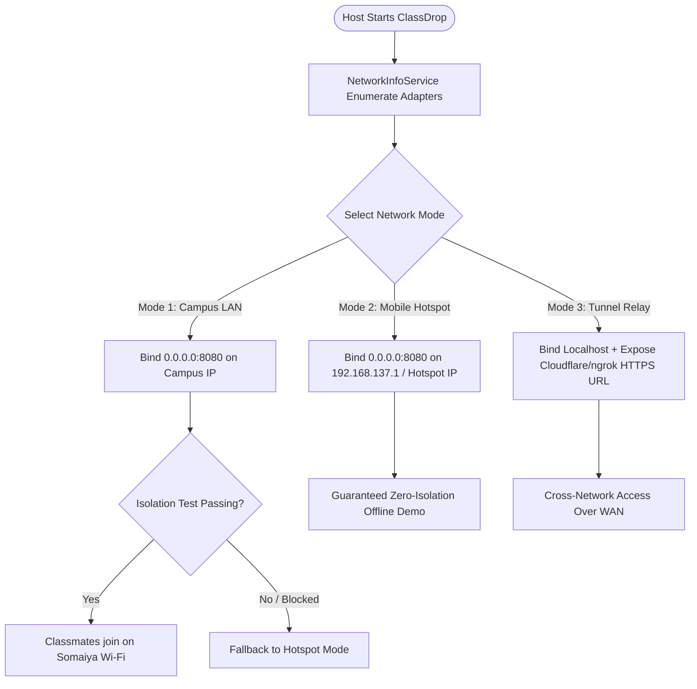
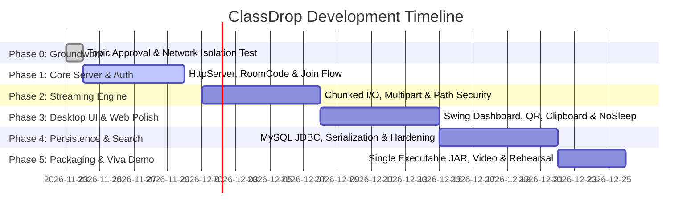

# ClassDrop — Master Engineering & Implementation Plan

**Target**: Production-grade Offline Classroom File & Code Sharing Platform  
**Academic Context**: KJSIM (KJ Somaiya Institute of Management) — MCA Java Mini Project  
**Author**: Farhan Sayed  
**Revision Date**: 23 November 2026 (Asia/Calcutta)  
**Stack**: Java 17+, Swing, `com.sun.net.httpserver.HttpServer`, JDBC + MySQL 8, JUnit 5, Vanilla Web Client (HTML5/CSS3/ES6)

---

## 1. Executive Summary & Dual-Horizon Vision

ClassDrop is a zero-cloud, lightweight local drop server and browser client that transforms a single laptop into a temporary classroom hub. Classmates connect over local Wi-Fi or hotspot via phone or PC to share lecture slides, assignment files, code snippets, and live clipboard contents instantly without installing any application.

```
                  ┌─────────────────────────────────────────────────────────┐
                  │                 HOST LAPTOP (Java 17+)                  │
                  │                                                         │
                  │   ┌─────────────────────────────────────────────────┐   │
                  │   │        Desktop Dashboard (Java Swing GUI)       │   │
                  │   │  Room Code | QR | Transfers | Devices | Stats   │   │
                  │   └────────────────────────┬────────────────────────┘   │
                  │                            │ Observer Updates           │
                  │   ┌────────────────────────▼────────────────────────┐   │
                  │   │          ClassDrop Core Engine                  │   │
                  │   │  • JDK HttpServer (Port 8080)                   │   │
                  │   │  • ThreadPoolExecutor (Concurrent I/O)          │   │
                  │   │  • Synchronized Room Registry                   │   │
                  │   │  • 64KB Chunked Stream Pipeline                 │   │
                  │   └────────────┬────────────────────────┬───────────┘   │
                  │                │ Local JDBC             │ Local Staging │
                  │   ┌────────────▼──────────┐  ┌──────────▼───────────┐   │
                  │   │ MySQL 8 History & Stats│  │ data/<sessionId>/    │   │
                  │   └───────────────────────┘  └──────────────────────┘   │
                  └────────────────────────▲────────────────────────────────┘
                                           │
                        HTTP/1.1 (LAN / Mobile Hotspot)
                                           │
                 ┌─────────────────────────┴─────────────────────────┐
                 │                                                   │
     ┌───────────┴───────────┐                           ┌───────────┴───────────┐
     │  Student Phone (Web)  │                           │ Student Laptop (Web)  │
     │  • Zero Install       │                           │ • Zero Install        │
     │  • NoSleep Keepalive  │                           │ • Drag-and-Drop       │
     │  • Direct Disk Stream │                           │ • Code & Clipboard    │
     └───────────────────────┘                           └───────────────────────┘
```

### The Dual Horizon

1. **Horizon 1 — Academic Excellence (MCA Mini Project)**:
   - 100% adherence to university syllabus requirements: OOP inheritance hierarchies, interfaces, abstract classes, constructor/method overloading, wrapper classes, custom exceptions, bounded multithreading, synchronized state, Java serialization, Swing GUI, and MySQL JDBC persistence.
   - Guaranteed demo reliability in the classroom regardless of campus network firewalls.
2. **Horizon 2 — Commercial & Organizational Portability**:
   - Packaged as an air-gapped, zero-config local sharing appliance for corporate boardrooms, offline examination halls, conference workshops, and air-gapped defense/banking networks where files cannot touch third-party cloud infrastructure (Google Drive, WeTransfer, Slack).

---

## 2. Somaiya Network Reality & Hybrid Connectivity Strategy

Campus Wi-Fi networks (such as Somaiya's 802.1X student login network) authenticate identity, but university network controllers frequently enable **Client/AP Isolation**. This silently discards direct device-to-device IP packets.

To guarantee zero-failure operation, ClassDrop implements a **3-Tier Network Resilience Strategy**:



### Mode Breakdown

| Mode | Target Scenario | Network Mechanics | Setup Requirement |
|---|---|---|---|
| **Mode 1: Campus LAN** | Classroom with open peer traffic | Host binds to Wi-Fi IPv4 (`10.x.x.x` or `192.168.x.x`). | Windows Firewall TCP 8080 open; isolation disabled on AP. |
| **Mode 2: Mobile Hotspot (Primary Viva Mode)** | Strict campus isolation / No internet | Host laptop enables Windows Mobile Hotspot (`192.168.137.1`) or connects to phone hotspot. | Complete isolation bypass; works 100% offline without internet. |
| **Mode 3: Relay Tunnel (Bonus)** | Inter-building / Remote students | Host runs embedded or local Cloudflare Tunnel / ngrok proxying to `localhost:8080`. | Outbound internet access required on host. |

### Host Windows Firewall Configuration

Windows silently drops incoming TCP on port 8080 by default. The host must execute this single command in an Administrator Command Prompt prior to testing:

```bat
netsh advfirewall firewall add rule name="ClassDrop HTTP 8080" dir=in action=allow protocol=TCP localport=8080 profile=private
```

---

## 3. Borrowing from ToffeeShare: What We Harvest & What We Avoid

[TOFFEESHARE_SYSTEM_ANALYSIS_AND_BUILD_PLAN.md](file:///D:/ShareDrop/docs/TOFFEESHARE_SYSTEM_ANALYSIS_AND_BUILD_PLAN.md) provided the reverse-engineered architectural baseline of ToffeeShare. Here is how ClassDrop systematically borrows its best UX and performance elements while remaining an academic Java powerhouse:

| Dimension | ToffeeShare Pattern | ClassDrop Production Adaptation |
|---|---|---|
| **Data Transport** | Browser WebRTC SCTP DataChannels + external STUN/TURN servers. Fails on isolated LANs without cloud relay. | **Host-Relayed HTTP/1.1** via JDK `HttpServer`. Works offline; enables centralized Swing dashboard, thread pool control, and JDBC history. |
| **Flow Control & Pacing** | Slices files into 2 MB buffers; transmits in 64 KB chunks with adaptive sleep (15–50 ms). | `FileService` processes streams in **64 KB chunks** (`byte[65536]`). No `readAllBytes()`. Never saturates JVM heap. |
| **Mobile Screen Lock** | Bundles `NoSleep.js` to keep mobile screens active during transfers. | Embedded `NoSleep.min.js` in web UI automatically triggered on session join to prevent student phones from sleeping mid-upload. |
| **Transfer Speed Smoothing** | 50-sample Exponential Moving Average (EMA). | Implements the formula $S_{new} = \frac{49 \cdot S_{prev} + \Delta B / \Delta t}{50}$ in `TransferTableModel` and web UI for smooth, non-jittery transfer speeds. |
| **Instant Room Pairing** | URL hash `#roomCode` + QR code. | QR code and share links encode `http://<host-ip>:8080/r/<6-digit>`. Phone camera scan immediately opens pre-filled join UI. |
| **Disk Streaming on Receiver** | File System Access API & StreamSaver.js. | Direct HTTP streaming download with `Content-Disposition: attachment; filename="..."` allowing native browser download engines to write straight to storage. |
| **Clipboard Sharing** | None (files only). | **Shared Classroom Clipboard** supporting short text, lecture formulas, and code snippets with language syntax highlighting. |

---

## 4. Academic Syllabus & Software Engineering Mapping

| Required Java Concept | Concrete Implementation in ClassDrop |
|---|---|
| **Classes, Objects & Constructors** | `RoomSession`, `Device`, `TransferRecord`, `ClipboardEntry`, `SharedItem`. Full constructor overloads for fresh creation vs. database rehydration. |
| **Abstract Classes & Interfaces** | Abstract class `SharedItem` extended by `ImageFile`, `DocumentFile`, and `CodeSnippet`. Interface `Transferable` provides stream access; interface `SessionListener` decouples server events from Swing UI. |
| **Method & Constructor Overloading** | `ClassDropServer.start()` vs `ClassDropServer.start(int port)` (for unit tests). `FileService.send(Path)` vs `FileService.send(Path, String roomCode)`. Multi-signature constructors on `SharedItem`. |
| **Inheritance & Wrapper Classes** | Polymorphic handling of shared items. Use of `Long`, `Integer`, and `Boolean` wrappers across HTTP headers, JSON payloads, and JDBC nullable result sets. |
| **Static & Final Constants** | `PORT = 8080`, `MAX_FILE_SIZE = 100 * 1024 * 1024L`, `ROOM_CODE_LENGTH = 6`, synchronized static session user counter tracking concurrent active students. |
| **Custom Exception Handling** | Hierarchy under `ClassDropException`: `InvalidRoomCodeException` (HTTP 403), `FileTooLargeException` (HTTP 413), `TransferFailedException` (HTTP 500), `SessionExpiredException` (HTTP 410). |
| **Multithreading & Concurrency** | Dedicated `ThreadPoolExecutor` (16 worker threads) for `HttpServer`. Synchronized memory structures for room and device registry. Lock-free stream-to-disk pipelines. Dedicated daemon `CleanupTask` running periodic expiry. Swing thread safety via `SwingUtilities.invokeLater()`. |
| **File Handling & Serialization** | Chunk-streamed disk writes in `data/<sessionId>/<uuid>`. Filename sanitization against path traversal (`../`). Native Java object serialization for `SessionSnapshot` (save and resume active rooms across app restarts). |
| **Desktop Swing GUI** | `ClassDropFrame` containing live transfer table, active device monitor, live stats panel, QR renderer, log pane, and clipboard viewer. |
| **JDBC & MySQL 8** | Database persistence with `PreparedStatement` only. Parameterized full-text search over transfer history. Aggregated analytics queries (`SUM(size_bytes)`, status counts). |

---

## 5. Complete Phase-Wise Implementation Roadmap



### Phase 0: Groundwork, Topic Approval & Network Verification (Day 1 — Nov 23)
- **Objective**: Freeze topic abstract, register with faculty, verify host machine setup, and record baseline network behavior.
- **Tasks**:
  1. Submit official topic approval abstract to faculty.
  2. Verify Java 17+ JDK and MySQL 8 local installations.
  3. Execute 2-minute campus Wi-Fi isolation test using `python -m http.server 8080` and `ping <host-ip>`.
  4. Initialize Git repository structure with `.gitignore` (ignoring `data/`, `.class`, target build folders).
- **Gate 0 Pass Criteria**: Topic registered; isolation status documented; Windows Hotspot verified; `javac -version` operational.

---

### Phase 1: Core Server Engine & Session Onboarding (Week 1: Nov 24 – Nov 30)
- **Objective**: Create working headless HTTP server capable of issuing room codes, validating devices, and returning tokens.
- **Tasks**:
  1. Define package structure: `com.classdrop.{model, exception, service, server, db, ui, util}`.
  2. Implement `RoomCodeGenerator`: cryptographically secure 6-digit numeric generator excluding ambiguous/sequential numbers.
  3. Build `NetworkInfoService`: enumerate active non-loopback network interfaces, filtering out virtual adapters (Docker, WSL, Hyper-V, VirtualBox) and identifying Hotspot IP (`192.168.137.1`).
  4. Implement `ClassDropServer` wrapping JDK `HttpServer`:
     - Bind to `0.0.0.0:8080`.
     - Allocate bounded thread pool (`Executors.newFixedThreadPool(16)`).
     - Register `GET /health`, `GET /`, `GET /r/{code}`, and `POST /join`.
  5. Build `JoinHandler`: validate room code, register student display name and IP in `RoomSession`, generate `authToken` (UUID), return device metadata.
  6. Create minimal responsive `index.html` (mobile-first join form).
- **Gate 1 Pass Criteria**: Phone on laptop hotspot visits `http://192.168.137.1:8080/r/123456`, successfully joins, receives auth token; invalid room code returns HTTP 403.

---

### Phase 2: High-Performance Chunked Streaming & Concurrency (Week 2: Dec 1 – Dec 7)
- **Objective**: Zero-RAM streaming file upload and download supporting simultaneous transfers without memory saturation.
- **Tasks**:
  1. Implement `FilenameSanitizer`: strip control chars, directory traversal prefixes (`../`, `..\`), normalize names, generate safe internal UUID storage paths.
  2. Write zero-dependency `MultipartParser`: stream `multipart/form-data` payloads directly to disk in `data/<sessionId>/` using fixed 64 KB buffers.
  3. Implement `UploadHandler` and `FileService`:
     - Enforce `MAX_FILE_SIZE = 100 MB` (configured via `application.properties`).
     - Throw `FileTooLargeException` early upon boundary overflow; automatically clean partial disk buffers.
     - Classify uploads into `ImageFile`, `DocumentFile`, or `CodeSnippet`.
  4. Implement `DownloadHandler`:
     - Stream file chunks to HTTP response with `Content-Disposition: attachment; filename="<sanitizedName>"`.
     - Validate caller token before serving.
  5. Implement `FilesHandler`: `GET /files` returning JSON array of available room items.
  6. Thread safety verification: ensure room item index updates are synchronized while disk I/O remains unblocked.
- **Gate 2 Pass Criteria**: 5 simultaneous uploads of 10 MB files complete without corruption; 100 MB file upload streams successfully; file over 100 MB returns HTTP 413; path traversal payloads rejected; MD5 checksum of downloaded file matches uploaded file.

---

### Phase 3: Desktop Swing Dashboard, QR, Clipboard & Web Client Polish (Week 3: Dec 8 – Dec 14)
- **Objective**: Complete host desktop application with graphical controls and production-grade web client.
- **Tasks**:
  1. Build `ClassDropFrame` (Swing):
     - Session control: Start, Pause Joins, End Session.
     - Connection header: Active Mode (LAN/Hotspot/Relay badge), Host IP, 6-digit Room Code.
     - One-click share actions: "Copy Link", "Share on WhatsApp" (`wa.me/?text=...`), "Email Link".
     - Prominent banner: *"Keep ClassDrop open on host — closing stops all sharing."*
     - Live tables: Connected Devices (`DeviceTableModel`) and Active Transfers (`TransferTableModel`).
     - Event Dispatch Thread safety: All UI updates routed via `SwingUtilities.invokeLater()`.
  2. Integrate QR generator (Nayuki pure-Java `qrcodegen`): render QR code of `http://<ip>:8080/r/<code>` directly into Swing panel.
  3. Implement Shared Classroom Clipboard:
     - Endpoints: `POST /clipboard` and `GET /clipboard`.
     - Swing clipboard viewer panel + Web client snippet box.
  4. Web Client Overhaul (`resources/web/`):
     - Dark UI theme with teal accent (`#0D9488`).
     - Drag-and-drop zone and multi-file selection.
     - Integration of `NoSleep.min.js` to prevent mobile sleep during transfers.
     - Real-time progress bars with Exponential Moving Average (EMA) speed smoothing.
     - Static `/about` and `/privacy` pages with the "Cloud vs. ClassDrop" architecture diagram.
- **Gate 3 Pass Criteria**: Entire workflow executed purely via UI: host starts room, phone scans QR, joins, uploads image; host dashboard shows live progress bar; second phone downloads file and reads shared clipboard snippet.

---

### Phase 4: Database Persistence, Search, Serialization & Hardening (Week 4: Dec 15 – Dec 21)
- **Objective**: Full academic syllabus integration (JDBC, serialization, search) and security hardening.
- **Tasks**:
  1. Apply `schema.sql` to local MySQL 8 database (`sessions`, `devices`, `transfers`, `snippets`).
  2. Implement `ConnectionFactory`: connection pooling / prepared statement management reading from `application.properties`.
  3. Implement Repositories (`SessionRepository`, `DeviceRepository`, `TransferRepository`, `SnippetRepository`).
  4. Build Swing `SearchPanel`: parameterized search over transfer history by filename, item kind, device name, and date range.
  5. Implement `StatsService`: real-time query aggregation (`COUNT(*)`, `SUM(size_bytes)`, success vs. failure rates) displayed on host dashboard.
  6. Implement Java Object Serialization:
     - `SessionSnapshot implements Serializable`: serialize in-memory active session state to disk (`session.ser`).
     - Implement snapshot save and restore mechanism allowing session recovery across app restarts.
  7. Implement background `CleanupTask`:
     - Run every 30 seconds to clean abandoned sessions, expired tokens, and purge staged disk files upon session termination.
  8. Execute full JUnit 5 test suite covering models, parsers, services, and sanitizers.
- **Gate 4 Pass Criteria**: Green JUnit 5 suite; search panel finds past files across restarts; `SessionSnapshot` restores state; MySQL verifies exact byte counts matching dashboard statistics.

---

### Phase 5: Commercial Packaging, Air-Gap Ready & Viva Rehearsal (Dec 22 – Dec 25)
- **Objective**: Polish for examiner demonstration and prepare zero-cloud enterprise packaging.
- **Tasks**:
  1. Build executable Fat JAR (`classdrop-1.0.0.jar`) via Maven Shade plugin or Ant script.
  2. Create zero-dependency Windows launcher batch script (`launch-classdrop.bat`) checking Java version and firewall rules automatically.
  3. Prepare air-gapped Dockerfile for enterprise deployment scenarios.
  4. Record 60-second backup demonstration video on phone/laptop hotspot in case campus hardware malfunctions during viva.
  5. Rehearse the 5-minute viva demo script (§7).
- **Gate 5 Pass Criteria**: Standalone JAR runs cleanly on fresh machine; 5-minute viva script fits time limits; all examiner questions answered confidently.

---

## 6. Complete Database Schema (MySQL 8)

```sql
CREATE DATABASE IF NOT EXISTS classdrop
  CHARACTER SET utf8mb4
  COLLATE utf8mb4_unicode_ci;

USE classdrop;

-- Sessions Table
CREATE TABLE sessions (
  id           CHAR(36)     NOT NULL,
  room_code    CHAR(6)      NOT NULL,
  started_at   DATETIME     NOT NULL,
  ended_at     DATETIME     NULL,
  mode         VARCHAR(20)  NOT NULL,   -- LAN, HOTSPOT, RELAY
  host_ip      VARCHAR(45)  NOT NULL,
  PRIMARY KEY (id),
  INDEX idx_sessions_started (started_at)
) ENGINE=InnoDB;

-- Connected Devices Table
CREATE TABLE devices (
  id            CHAR(36)     NOT NULL,
  session_id    CHAR(36)     NOT NULL,
  display_name  VARCHAR(80)  NOT NULL,
  ip_address    VARCHAR(45)  NULL,
  joined_at     DATETIME     NOT NULL,
  last_seen     DATETIME     NOT NULL,
  PRIMARY KEY (id),
  CONSTRAINT fk_devices_session
    FOREIGN KEY (session_id) REFERENCES sessions(id) ON DELETE CASCADE
) ENGINE=InnoDB;

-- Transfers Audit & History Table
CREATE TABLE transfers (
  id             CHAR(36)      NOT NULL,
  session_id     CHAR(36)      NOT NULL,
  device_id      CHAR(36)      NOT NULL,
  item_kind      VARCHAR(20)   NOT NULL,  -- IMAGE, DOCUMENT, SNIPPET
  original_name  VARCHAR(255)  NOT NULL,
  stored_name    VARCHAR(80)   NOT NULL,
  size_bytes     BIGINT        NOT NULL,
  content_type   VARCHAR(120)  NULL,
  direction      VARCHAR(10)   NOT NULL,  -- UPLOAD, DOWNLOAD
  status         VARCHAR(20)   NOT NULL,  -- OK, FAILED, EXPIRED
  file_token     CHAR(36)      NULL,
  created_at     DATETIME      NOT NULL,
  PRIMARY KEY (id),
  INDEX idx_transfers_search (original_name, item_kind, created_at),
  CONSTRAINT fk_transfers_session
    FOREIGN KEY (session_id) REFERENCES sessions(id) ON DELETE CASCADE,
  CONSTRAINT fk_transfers_device
    FOREIGN KEY (device_id) REFERENCES devices(id) ON DELETE CASCADE
) ENGINE=InnoDB;

-- Shared Snippets / Clipboard Table
CREATE TABLE snippets (
  id          CHAR(36)      NOT NULL,
  session_id  CHAR(36)      NOT NULL,
  device_id   CHAR(36)      NOT NULL,
  title       VARCHAR(120)  NULL,
  language    VARCHAR(40)   NULL,
  body        MEDIUMTEXT    NOT NULL,
  created_at  DATETIME      NOT NULL,
  PRIMARY KEY (id),
  CONSTRAINT fk_snippets_session
    FOREIGN KEY (session_id) REFERENCES sessions(id) ON DELETE CASCADE,
  CONSTRAINT fk_snippets_device
    FOREIGN KEY (device_id) REFERENCES devices(id) ON DELETE CASCADE
) ENGINE=InnoDB;
```

---

## 7. 5-Minute Examination Viva Script & Examiner Defense Cheat Sheet

### Time-Stamped Demo Script

* **0:00 – 0:45 (Architecture Pitch)**:
  > *"Examiners, ClassDrop is a zero-cloud classroom file and code drop box designed in Java 17. Unlike cloud services like Google Drive or WeTransfer that route student files to third-party servers, ClassDrop turns this host laptop into the local relay hub. Guests install zero software—they connect via phone or laptop browser. Because campus Wi-Fi networks frequently enforce client/AP isolation, we built a dedicated Mobile Hotspot fallback mode so this system functions 100% offline."*
* **0:45 – 1:30 (Host Dashboard Inspection)**:
  > *"On the Swing host dashboard, you see our active network mode, detected host IP, 6-digit room code, and dynamically generated QR code. Notice the active-session keepalive warning. Transfers run through an embedded JDK `HttpServer` on port 8080 managed by a bounded 16-thread pool."*
* **1:30 – 3:00 (Live Multi-Device Operation)**:
  > *(Scan QR on student phone; join room).*
  > *"My phone has joined without typing a URL. I will drag and drop a 25 MB lecture PDF and an image. On the host, observe the live `TransferTableModel` updating with Exponential Moving Average (EMA) smoothed speeds. Simultaneously, a student posts a Java code snippet to the shared clipboard, which appears instantly on both the host and other connected phones."*
* **3:00 – 4:00 (Syllabus & Engineering Proof)**:
  > *"Under the hood, files are streamed in 64 KB chunks directly to disk—we never buffer full files in memory. Our class hierarchy uses an abstract `SharedItem` with polymorphic subclasses `ImageFile`, `DocumentFile`, and `CodeSnippet`. All transfers are logged to MySQL using parameterized JDBC statements. Here is the search panel querying transfer records, and our serialization routine saving session snapshots."*
* **4:00 – 5:00 (Termination & Clean Exit)**:
  > *(Click End Session on Swing dashboard).*
  > *"When the host terminates the session, all room codes and tokens expire immediately, and our cleanup thread purges staged files from disk. File bytes never leave the room."*

### Rapid Examiner Defense Cheat Sheet

| Likely Examiner Question | Master Defense Response |
|---|---|
| **Why didn't you use WebRTC peer-to-peer like ToffeeShare?** | *"WebRTC peer-to-peer requires external STUN/TURN signaling servers to traverse NATs and completely fails on campus networks with client isolation unless traffic is routed through costly cloud relays. Furthermore, an embedded Java HTTP architecture allows host-side verification, Swing monitoring, thread pooling, and JDBC logging prescribed in our syllabus."* |
| **Why not Spring Boot or Tomcat?** | *"Spring Boot and external Tomcat containers add tens of megabytes of boilerplate that hide core networking. Using JDK's built-in `com.sun.net.httpserver.HttpServer` proves mastery of raw sockets, thread pool allocation, HTTP protocol headers, and manual multipart stream parsing."* |
| **What prevents memory crashes if 10 students upload 100 MB files simultaneously?** | *"We strictly forbid `readAllBytes()` or loading files into heap arrays. The `MultipartParser` uses a fixed 64 KB buffer directly streaming from the socket input stream into a disk file descriptor. Memory consumption remains constant regardless of file size."* |
| **How does ClassDrop prevent path traversal attacks?** | *"The `FilenameSanitizer` utility strips all directory path separators (`/`, `\`), eliminates `..` sequences, and stores files using synthetic UUIDs (`data/<sessionId>/<uuid>`). The user-supplied name is stored only as database metadata."* |
| **How is your code structured for commercial deployment?** | *"The core server is entirely decoupled from the Swing GUI via the `SessionListener` interface. It can be compiled into a headless daemon, containerized with Docker, and deployed on air-gapped corporate LANs or training centers with zero cloud dependencies."* |

---

## 8. Immediate Next Actions

1. Review and submit the topic approval abstract (§17 in [ClassDrop_Build_Plan.md](file:///D:/ShareDrop/docs/ClassDrop_Build_Plan.md)).
2. Confirm the inbound firewall rule on your host laptop via Administrator Command Prompt.
3. Proceed directly to **Phase 1** scaffolding using the established package structure.
