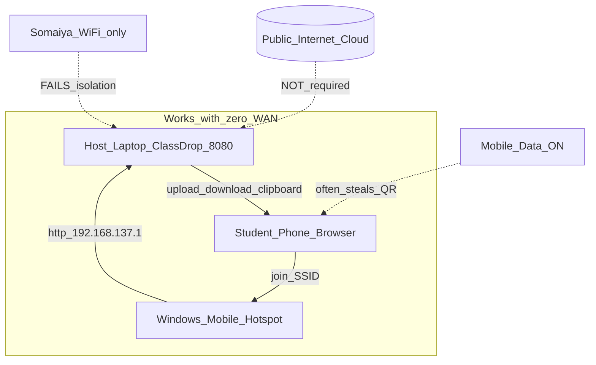

# ClassDrop — Full Offline Connection Deep Dive & Enhancement Plan

**Date:** 2026-11-24  
**Status:** ✅ Complete (FO-0 … FO-2 + FO-3.1/3.4; FO-3.2 HTTPS & FO-3.3 Bluetooth permanently out of scope)  
**Purpose:** Decide exactly how ClassDrop attains **full offline file sharing** (zero public internet), what is already true, what cannot be invented in software, and what enhancements to build.  
**Audience:** Product owner / viva / implementation backlog.

---

## Executive verdict

| Question | Answer |
|---|---|
| Can files be shared with **zero public internet**? | **Yes — already architecturally true** via Windows Mobile Hotspot + local HTTP. |
| Is “offline broken” usually a code bug? | **Usually no** — it is the **student phone path** (wrong Wi‑Fi, cellular steal, firewall). |
| What does “full offline” mean for ClassDrop? | Host and students need **no WAN/cloud**, but they **must share a private local Wi‑Fi** (host hotspot). |
| Best path forward? | **Productize the hotspot hub** (P0/P1 below). Do **not** replace with Bluetooth/cloud as the core. |

---

## 1. Deep diagnosis — current system

### 1.1 What already works offline (code-proven)

| Layer | Status | Evidence |
|---|---|---|
| Server bind | ✅ | `ClassDropServer` binds `0.0.0.0:8080` |
| Local HTTP APIs | ✅ | `/join`, `/upload`, `/files`, `/download`, `/clipboard`, `/events` |
| Static web (no CDN) | ✅ | Bundled `web/` via `StaticHandler`; system fonts; local `nosleep.min.js` |
| Local QR | ✅ | Nayuki in-process (no Google Charts) |
| MySQL optional | ✅ | In-memory fallback |
| Hotspot detect | ✅ | `NetworkInfoService` looks for `192.168.137.1` |
| Offline UX | ✅ (partial) | OFFLINE READY banner, connect guide, invite pack, `/connect`, `/network-status` |
| Captive stubs | ⚠️ limited | Local `/generate_204` etc. — phones usually probe **Google/Apple on the internet**, not ClassDrop |

**Conclusion:** The JAR does **not** need internet to transfer files. Transfers are pure local HTTP streams on the hotspot subnet.

### 1.2 Failure modes when people say “offline is not working”

| # | Failure | Root cause | Fixable in ClassDrop? |
|---|---|---|---|
| F1 | Students on campus Wi‑Fi only | AP **client isolation** | ❌ Cannot bypass in browser app |
| F2 | QR opens but page never loads | Phone uses **cellular** for the link | ⚠️ Warn + force data-off discipline |
| F3 | Hotspot OFF, QR shows LAN IP | Wrong network path | ✅ Detect + gate QR / heal session |
| F4 | Timeout on hotspot | **Windows Firewall** blocks 8080 (often “Public” profile) | ✅ In-app firewall launch + profile=any rule |
| F5 | “No Internet” → student leaves hotspot | Phone UX | ⚠️ Educate + stay-connected messaging |
| F6 | Host expects zero radio | Misunderstanding of “offline” | Docs / viva script |
| F7 | Many students stall uploads | SSE holds threads in 16-pool | ✅ Dedicated SSE executor |
| F8 | Hotspot won’t start with no uplink | Some Windows builds need **loopback adapter** | ⚠️ Document + script (OS setup) |

### 1.3 Industry pattern (same architecture as successful tools)

Tools like HostDrop / TokShare / pocket-share use the **same model**:

1. Laptop creates Mobile Hotspot (even without internet).  
2. Phone joins hotspot.  
3. Phone opens `http://192.168.137.1:PORT` in browser.  
4. Files stay local — no cloud.

Their classroom advice matches ours: **stay connected despite “No Internet”**, allow firewall on the hotspot/public profile, prefer **mobile data off**.

---

## 2. Locked product definition of “full offline”

### Decision D1 — Definition

> **Full offline ClassDrop** = host laptop + student devices exchange files/code with **no public internet, no cloud, no STUN/TURN, no student app install**, using a **private local network created by the host (Mobile Hotspot)** or an open LAN.

### Decision D2 — What we will never claim

- Students stay **only** on isolated Somaiya Wi‑Fi while host has **no** path to them.  
- Phones join with **mobile data preferred** and still always hit `192.168.137.1`.  
- Zero-radio sharing (except USB sneakernet as optional assist).

### Decision D3 — Architecture choice

| Option | Decision |
|---|---|
| Hotspot + local HTTP + browser (current) | **KEEP AS CORE** |
| Internet Share tunnel | Optional secondary only |
| Wi‑Fi Direct / Bluetooth primary | Reject for core (kills zero-install + MCA story) |
| Native student app | Reject for core (install friction) |
| Cloud SaaS host | Reject (kills offline USP) |

---

## 3. Target classroom proof (acceptance test)

Must pass with **host Wi‑Fi/Ethernet unplugged or airplane-mode uplink**:

1. Host Mobile Hotspot ON → ClassDrop shows **OFFLINE READY**.  
2. Firewall rule allowed once.  
3. Phone joins hotspot, **mobile data OFF**.  
4. Scan QR → join → upload PDF → host sees transfer → other phone downloads.  
5. Clipboard snippet posts and appears on second device.  
6. End session → tokens die.

If this fails, debug F2–F5 first — not “rewrite networking.”

---

## 4. Enhancement roadmap (what to build)

### Phase FO-0 — Truth & packaging (docs / distribution) — Effort: S

| ID | Work | Outcome |
|---|---|---|
| FO-0.1 | One-page **Offline Cheat Sheet** PDF/MD for projector | Teachers stop improvising |
| FO-0.2 | Viva **airplane-mode demo** script | Proves zero-WAN transfers |
| FO-0.3 | Loopback-adapter note when hotspot won’t start without internet | Unblocks some Windows PCs |
| FO-0.4 | Align older docs (`ENHANCEMENT_PLAN`) with shipped hotspot + Internet Share | No contradictory claims |

**Deliverable:** `docs/OFFLINE_CHEAT_SHEET.md` + viva checklist item.

---

### Phase FO-1 — Demo-proof path (must build next) — Effort: S–M

| ID | Work | Why | Effort |
|---|---|---|---|
| FO-1.1 | **In-app “Fix Firewall” button** launches `allow-firewall-8080.bat` + Admin instructions; rule uses `profile=any` | #1 silent classroom killer | S |
| FO-1.2 | **Gate QR quality**: if hotspot not ready, show red “NOT READY” overlay on QR instead of a scannable wrong URL | Stops false confidence | S |
| FO-1.3 | **Pre-join mobile-data gate** on web (checkbox: “I turned off mobile data / I’m on teacher Wi‑Fi”) | Cuts F2 failures | S |
| FO-1.4 | Teacher fields for **SSID + password** in invite pack (typed once) | Cannot auto-read OS secrets; still huge UX win | S |
| FO-1.5 | Host panel: list **all local IPs** + exact URL to write on board | Wrong-NIC / heal clarity | S |
| FO-1.6 | First-student “connection probe” chime/log when `/network-status` or `/join` succeeds from non-localhost | Host knows path is live | S |

**Success:** New faculty can get first phone join in &lt; 2 minutes without developer help.

---

### Phase FO-2 — Scale & convenience (still fully offline) — Effort: M

| ID | Work | Why | Effort |
|---|---|---|---|
| FO-2.1 | **Dedicated SSE thread pool** (don’t share 16-worker upload pool) | 30–40 students won’t starve transfers | M |
| FO-2.2 | **jmDNS / `http://classdrop.local:8080`** | Easier than raw IP; still offline | M |
| FO-2.3 | Dual QR: optional **Wi‑Fi join hint card** (SSID text QR) + ClassDrop room QR | TokShare-style two-step mental model | M |
| FO-2.4 | Projector **poster export** (PNG/PDF of code + URL + QR) | Lecture-hall scale | M |
| FO-2.5 | Hotspot subnet robustness beyond hardcoded `192.168.137.1` (interface name heuristics) | Newer Windows edge cases | M |
| FO-2.6 | Auto-set Windows firewall on first listen attempt with clear UAC prompt path | Fewer script steps | M |

**Success:** Full lab section joins without SSE/upload collapse; memorable URL optional.

---

### Phase FO-3 — Stretch differentiators — Effort: M–L

| ID | Work | Note |
|---|---|---|
| FO-3.1 | USB drop-folder watch on host | Sneakernet when radio fails |
| FO-3.2 | Self-signed local HTTPS | Security story; trust UX cost |
| FO-3.3 | Optional Bluetooth assist | Never replace browser path |
| FO-3.4 | Reverse mode: join **phone hotspot**, host connects as client | Useful when laptop Wi‑Fi can’t AP; document data-meter risk |

---

## 5. What NOT to build (anti-backlog)

1. Making campus-Wi‑Fi-only offline joins the primary promise.  
2. Replacing host hub with WebRTC cloud relays for “offline.”  
3. Requiring student app install for the default path.  
4. Claiming captive-portal endpoints alone fix “No Internet” on stock Windows hotspot.  
5. Spending MCA timeline on full Nearby Share clone.

---

## 6. Build status

| Sprint | Items | Status |
|---|---|---|
| A (FO-1) | Firewall, QR gate, web checkbox, SSID fields, IP list, join chime | ✅ Done |
| B (FO-2.1 + FO-0) | Expanded HTTP+SSE pool, cheat sheet, loopback note, docs | ✅ Done |
| C (FO-2.2–2.5) | mDNS, poster export, hotspot subnet heuristics | ✅ Done |
| D (FO-3) | USB drop folder + reverse phone-hotspot detect | ✅ Done |
| — | FO-3.2 local HTTPS, FO-3.3 Bluetooth | ❌ Out of scope (anti-backlog) |

## 7. Shipped implementation map

| ID | Where |
|---|---|
| FO-1.1 Fix Firewall | `ClassDropFrame.runFirewallHelper` + `scripts/allow-firewall-8080.bat` |
| FO-1.2 QR NOT READY | `lblQrNotReady` overlay when hotspot down |
| FO-1.3 Mobile-data gate | `index.html` + `app.js` checkbox |
| FO-1.4 SSID/password | Swing fields → Copy Invite Pack |
| FO-1.5 IP list | `NetworkInfoService.getInterfaceSummaries` |
| FO-1.6 Join chime | `onDeviceJoined` beep for remote students |
| FO-2.1 SSE capacity | `Constants.HTTP_EXECUTOR_SIZE` (16+48) |
| FO-2.2 mDNS | `MdnsService` → `http://classdrop.local:8080` |
| FO-2.4 Poster | `PosterExportService` + Export Poster button |
| FO-2.5 Hotspot detect | `192.168.137.*` + adapter name heuristics |
| FO-2.3 Dual Wi‑Fi QR | `WifiQrPayload` + second QR card in Swing |
| FO-2.6 Firewall first prompt | `maybePromptFirewallOnce` on first HOTSPOT ready session |
| FO-3.1 USB drop folder | `DropFolderWatcher` → `data/drop-inbox` |
| FO-3.4 Reverse mode | Detect phone hotspot + `PHONE_HOTSPOT_REVERSE_MODE.md` |
| Start Hotspot script | `scripts/enable-mobile-hotspot.ps1` + UI button |
| FO-3.2 / FO-3.3 | **Not building** — TLS trust UX / Bluetooth break zero-install USP |

---

## 8. Risk register

| Risk | Mitigation |
|---|---|
| Windows refuses hotspot with no WAN | Document Microsoft Loopback adapter share trick |
| Students ignore data-off tip | Checkbox + projector cheat sheet + verbal script |
| Firewall Admin denied | Show exact `netsh` command to copy |
| 40+ concurrent SSE | FO-2.1 dedicated pool + polling already exists as backup |
| Desktop PC without Wi‑Fi | Cannot host hotspot — use phone-hotspot reverse mode (FO-3.4) or Ethernet LAN |

---

## 9. Success metrics

| Metric | Target |
|---|---|
| Airplane-mode host demo | Pass |
| Time to first student join (trained host) | ≤ 2 minutes |
| Join success with data OFF + hotspot ON | ≥ 95% in lab trials |
| False “ready” QR when hotspot OFF | 0 |
| Concurrent students transferring | ≥ 30 without upload starvation (after FO-2.1) |

---

## 10. One-page summary for viva

**How ClassDrop is offline:** The teacher laptop becomes a private Wi‑Fi hub (Mobile Hotspot). ClassDrop serves a local website on `192.168.137.1:8080`. Students join that Wi‑Fi and use the browser — files never touch the cloud.

**Why campus Wi‑Fi alone fails:** Isolation blocks phone→laptop. Hotspot bypasses that.

**Why phones still fail sometimes:** Cellular steals the connection; firewall blocks port 8080; hotspot was off. Those are operational, and Phase FO-1 productizes the fixes.

**What shipped for reliability:** Firewall one-click, QR readiness gate, mobile-data join gate, SSID invite pack, SSE capacity, mDNS, projector poster.

---

## Related documents

- [OFFLINE_SHARING_PLAN.md](OFFLINE_SHARING_PLAN.md) — strategy decision  
- [OFFLINE_CONNECTIVITY_HARDENING.md](OFFLINE_CONNECTIVITY_HARDENING.md) — earlier hardening notes  
- [INTERNET_SHARE_GUIDE.md](INTERNET_SHARE_GUIDE.md) — online escape hatch only  
- [LOCAL_RUN_GUIDE.md](LOCAL_RUN_GUIDE.md) — hotspot setup  

---

## Decision / completion

**Approved direction:** Keep hotspot HTTP hub.  
**Completed:** FO-0 + FO-1 + FO-2 + FO-3.1 USB drop folder + FO-3.4 reverse phone-hotspot path + auto Start Hotspot script.  
**Permanently out of scope:** FO-3.2 self-signed HTTPS (trust friction) and FO-3.3 Bluetooth assist (breaks zero-install browser USP).
