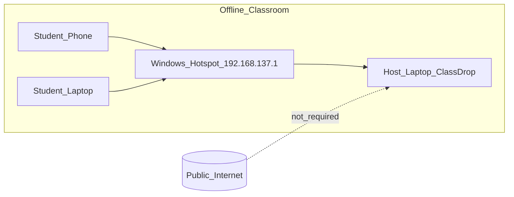

# ClassDrop — Offline Sharing Decision & Plan

**Status:** Decision locked (product strategy)  
**Date:** 2026-11-23  
**Goal:** Make ClassDrop a **needful, offline-first** classroom file/code hub — usable with **zero public internet**, while keeping Internet Share as an optional escape hatch.

---

## 1. The honest definition of “offline”

People say “offline” and mean different things. ClassDrop must pick **one clear meaning**.

| Meaning people say | Physically possible? | ClassDrop stance |
|---|---|---|
| **A. No public internet / no cloud / no cellular data** | Yes | **This is ClassDrop’s primary USP** |
| **B. Devices share with zero radio/link of any kind** | No (except USB cable / sneakernet) | Out of scope for browser QR sharing |
| **C. Students stay on Somaiya Wi-Fi, host stays offline** | Usually **No** — campus client isolation blocks phone→laptop | Use **host hotspot**, not campus Wi-Fi |
| **D. Host has no uplink, students outside the room join** | Impossible without a path | Use Internet Share only when host *has* uplink |

### Decision (locked)

> **Offline ClassDrop = sharing over a private local network created by the host (Windows Mobile Hotspot or open LAN), with zero dependency on internet, cloud, STUN/TURN, or student installs.**

That is already the designed core of ClassDrop. Internet Share is **optional**, not the identity of the product.

---

## 2. What already works offline today

ClassDrop already supports true offline classroom sharing:

1. Host enables **Windows Mobile Hotspot**.
2. Host runs ClassDrop in **HOTSPOT** mode (`192.168.137.1:8080`).
3. Students join the hotspot Wi-Fi (no internet required on that Wi-Fi).
4. Students open QR / `http://192.168.137.1:8080/r/CODE` in a browser.
5. Files and clipboard move **host ↔ students** through the laptop HTTP server.
6. MySQL can be offline — in-memory fallback still works.
7. QR is generated **locally** (Nayuki), not via Google Charts APIs.

**Verdict:** Offline connectivity is **not a missing feature** — it is the default product path. What is missing is **product clarity, host UX polish, and reliability hardening** so faculty/students *trust* and *choose* offline mode every time.

---

## 3. Decision matrix — what we will / will not build

### Chosen product model: **Offline-first hub + optional Internet Share**

| Option | Description | Decision | Why |
|---|---|---|---|
| **1. Offline-only (Hotspot/LAN only)** | Remove Internet Share | Rejected as sole model | Real demos sometimes need outside-network join |
| **2. Cloud-hosted ClassDrop (Vercel/AWS)** | Abandon host-laptop USP | **Rejected** | Kills offline USP and academic story |
| **3. Pure P2P WebRTC offline** | Browser-to-browser | **Rejected for core** | Breaks under isolation; needs signaling; weak host control |
| **4. Offline-first + optional tunnel** | Hotspot default; INTERNET optional | **ACCEPTED** | Best of both worlds; already partially built |
| **5. Bluetooth / Nearby Share clone** | OS-native short-range | **Defer / out of MCA core** | Different stack; not zero-install browser |
| **6. USB OTG / SD sneakernet assist** | Manual file copy helper | **Optional later** | Useful fallback, not primary UX |

### Locked principles

1. **Default mode = HOTSPOT (offline).** Internet is never required for a normal classroom.
2. **Internet Share stays secondary** and must show a clear warning + mandatory passphrase.
3. **Never claim** “works for outside students with zero host internet” — that is physically false.
4. **Never claim** “works while students stay only on isolated campus Wi-Fi” without hotspot — that usually fails.
5. Keep **zero student install** for the primary offline path.

---

## 4. The two offline network recipes (teach this in viva)

### Recipe A — Primary (recommended): Host Mobile Hotspot

**When:** Campus Wi-Fi isolates clients; no reliable internet; exam halls; basements.

| Step | Actor | Action |
|---|---|---|
| 1 | Host | Turn on Windows Mobile Hotspot |
| 2 | Host | Launch ClassDrop → Mode **HOTSPOT** |
| 3 | Students | Connect to host hotspot SSID |
| 4 | Students | Scan QR / open local HTTP URL |
| 5 | All | Share files — **no internet used** |

**Success criteria:** Phone shows hotspot Wi-Fi connected (may say “no internet” — that is OK).

### Recipe B — Secondary: Open LAN / lab switch

**When:** Lab network allows client-to-client or client-to-host traffic.

| Step | Actor | Action |
|---|---|---|
| 1 | Host | Connect to same LAN as students |
| 2 | Host | Mode **LAN**, open firewall TCP 8080 |
| 3 | Students | Open `http://HOST_IP:8080/...` |

**Risk:** Many campus APs still isolate — if join fails, fall back to Recipe A.

### Recipe C — Optional online escape: Internet Share

Only when students cannot join hotspot (different building, cellular-only). Host **must** have uplink. See [INTERNET_SHARE_GUIDE.md](INTERNET_SHARE_GUIDE.md).

---

## 5. Gap analysis — what “better offline” still needs

Offline *exists*, but these gaps decide whether people call it “needful”:

| Gap | Impact | Priority | Effort |
|---|---|---|---|
| **Offline-first UX copy** (“Works without internet” banner, mode explanations) | Users think Internet Share is required | **P0** | Low |
| **One-click Hotspot checklist** in Swing (detect hotspot adapter, firewall tip, “students must join this Wi-Fi”) | Demo failures | **P0** | Low–Med |
| **Captive / “No internet” student confusion** — web page explains “No internet on hotspot is normal” | Support load | **P0** | Low |
| **Airplane-mode host proof** (disable uplink, still share) as documented viva demo | Credibility | **P0** | Docs only |
| **Local mDNS / hostname** (`http://classdrop.local`) | Easier than raw IP | P1 | Medium |
| **Windows Firewall auto-rule helper** (prompt/script) | First-run friction | P1 | Medium |
| **APK-free offline still**; optional tiny companion only if needed | Keep USP | P1 | High if done |
| **Bluetooth file assist** | Niche | P2 | High |
| **Fully air-gapped signed offline installer + docs pack** | Distribution | P1 | Low–Med |

---

## 6. Implementation plan (phased)

### Phase O0 — Positioning (now / this week) ✅ decision + docs

- [x] Keep HOTSPOT/LAN as primary; INTERNET as optional.
- [x] Document truth in this file + Internet Share guide.
- [x] README leads with Hotspot; App tip prefers offline.
- [x] In-app banner: **“Offline mode — no internet required…”**

### Phase O1 — Offline reliability UX ✅ implemented

1. **Offline readiness panel** in Swing — hotspot detect + OFFLINE READY / tip banner
2. **Student web tip** — “No Internet is normal on teacher hotspot”
3. **INTERNET confirm** — “This leaves offline-only mode” + room-code change warnings
4. **Firewall helper** — `scripts/allow-firewall-8080.bat`
5. **Tunnel lifecycle fixes** — stop on cancel/timeout/session cleanup; passphrase at session create

### Phase O2 — Offline convenience

1. Optional `classdrop.local` via mDNS (jmDNS) — still offline.
2. Firewall helper: generate a PowerShell one-liner / `.bat` to allow TCP 8080.
3. “Copy hotspot SSID + password + room code” single clipboard pack for teacher.
4. Session QR poster PDF export for projector (offline generated).

### Phase O3 — Stretch (only if time)

1. USB “drop folder watch” on host for sneakernet intake.
2. Optional Android Nearby/Bluetooth bridge — **do not replace** browser path.
3. Self-signed local HTTPS on hotspot (security story) — still offline.

---

## 7. What we will explicitly NOT do (this product generation)

1. **Replace host hub with cloud SaaS** as the main mode.
2. **Promise campus-Wi-Fi-only offline joins** under client isolation.
3. **Require internet for QR generation, fonts, analytics, or auth**.
4. **Force students to install an app** for the primary path.
5. **Claim magic reachability** to phones that are not on the host’s local network and have no tunnel path.

---

## 8. Recommended product messaging (use everywhere)

**Primary tagline (keep):**  
> In the room, in the browser, off the cloud.

**Offline subline (add):**  
> No internet needed — join the teacher’s hotspot, scan the QR, share.

**Internet subline (secondary):**  
> Optional Internet Share when people cannot join the hotspot (host uplink + passphrase required).

**Viva one-liner:**  
> ClassDrop is offline-first: the laptop becomes a private classroom server on Mobile Hotspot. Internet Share is only a bolt-on for out-of-room guests.

---

## 9. Success metrics (how we know offline is “needful”)

| Metric | Target |
|---|---|
| Classroom demo with host Wi-Fi/cellular **disabled** | Files still transfer |
| Student phone shows “No internet” on hotspot | Still can open ClassDrop and download |
| Time for first student join after hotspot on | &lt; 60 seconds with checklist |
| Faculty understands Local vs Internet | Can explain both without notes |
| Dependency on cloud during offline demo | **Zero** |

---

## 10. Immediate next actions (engineering backlog)

Ordered by value for the “offline needful product” story:

| # | Task | Outcome |
|---|---|---|
| 1 | Lead README / USP / viva with **Offline Hotspot** before Internet Share | Correct mental model |
| 2 | Swing **OFFLINE READY** checklist panel | Fewer failed demos |
| 3 | Web banner for local joins: “No internet is OK” | Fewer student drop-offs |
| 4 | Confirm dialog when switching to INTERNET | Protects offline USP |
| 5 | Firewall allow-8080 helper script | Windows first-run success |
| 6 | (Optional) mDNS `classdrop.local` | Nicer offline URLs |

---

## 11. Final decision summary

| Question | Decision |
|---|---|
| Can ClassDrop be fully offline? | **Yes — via HOTSPOT/LAN. That is the core product.** |
| Is more invention required for basic offline sharing? | **No for the transport model; yes for UX hardening.** |
| Should we remove Internet Share? | **No — keep as optional secondary mode.** |
| Best path to a “very needful” offline tool? | **Make Hotspot mode unmistakable, reliable, and demo-proof.** |
| Killer mistake to avoid? | **Marketing Internet Share as the main idea and diluting the offline USP.** |

**Bottom line:**  
Offline sharing is already the right architecture. The win is not inventing a new network protocol — it is **forcing the product, docs, and UI to treat Hotspot offline as the hero path**, and treating Internet Share as a clearly labeled exception.

---

## Related docs

- [INTERNET_SHARE_GUIDE.md](INTERNET_SHARE_GUIDE.md) — optional online escape hatch  
- [USP_AND_CREATIVE_ROADMAP.md](USP_AND_CREATIVE_ROADMAP.md) — USP framing  
- [LOCAL_RUN_GUIDE.md](LOCAL_RUN_GUIDE.md) — hotspot classroom setup  
- [VIVA_PRESENTATION_SCRIPT.md](VIVA_PRESENTATION_SCRIPT.md) — examiner answers  

---

*When you want Phase O1 implemented in code (checklist panel + banners + INTERNET confirm), say the word and we build it next.*
